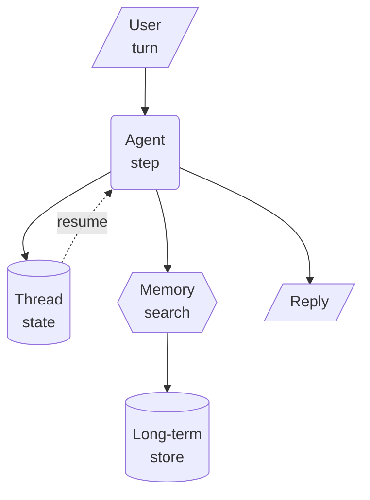

# Agent Memory

A chat window is amnesia with good typography. Close the tab and the agent forgets your name, your stack, the decision you made last Tuesday, and the fact that it already tried the approach you are about to suggest. The context window is not memory; it is a desk that gets cleared every session.

Memory is the part of an agent that survives the clearing. It is also where a lot of production incidents come from, because a store that remembers the wrong thing is worse than one that forgets.

```callout
**In one sentence:** short-term memory is the current thread's state, persisted so it can resume; long-term memory is a separate store you write to and query — and the hard parts are deciding what to write, when to forget, and which user is allowed to read it.
```

## Two clocks

LangGraph's docs draw the cleanest line between the two:

- **Short-term memory** is thread-scoped. It tracks the ongoing conversation, lives in the agent's state, and is persisted by a checkpointer so the thread can be resumed later. It updates when the graph is invoked or a step completes.
- **Long-term memory** is cross-thread. It stores user- or application-level data that can be recalled at any time, in any thread, scoped by a custom namespace rather than a thread ID.

The distinction matters because they fail differently. Short-term memory fails by overflowing or going stale inside one conversation. Long-term memory fails by being wrong, duplicated, leaked, or impossible to retrieve.



## Short-term memory is a checkpoint

A thread is the unit of continuity, the way an email thread groups messages. The checkpointer writes state at each step, so a crashed process can pick the conversation back up without replaying it from the top.

State is not only messages. LangGraph's docs note it can hold uploaded files, retrieved documents, and generated artifacts. That is useful and expensive: every item you keep is context you pay for on the next call.

Long conversations break in two ways. The history may not fit the window at all, or it may fit while making the model worse — LangGraph's guide is blunt that most LLMs "get distracted by stale or off-topic content" even inside their advertised context length. The usual fixes:

| Technique | What it does | Cost |
| --- | --- | --- |
| Trim | Drop the oldest turns | Loses early commitments |
| Summarise | Replace old turns with a summary | Summary drifts from the source |
| Filter | Keep only turns relevant to the current task | Needs a relevance step |
| Externalise | Move artifacts to files or a store, keep references | Agent must fetch them back |

Trimming is the default because it is cheap. Summarising is better for long support conversations. Externalising is what coding agents do when they write a plan to a file instead of holding it in the transcript.

## Long-term memory is a database with a retrieval policy

LangGraph groups long-term memory the way psychology does:

| Type | What is stored | Agent example |
| --- | --- | --- |
| **Semantic** | Facts | The user's timezone, plan tier, stack |
| **Episodic** | Experiences | Past actions, what worked, what failed |
| **Procedural** | Instructions | A refined system prompt or playbook |

Semantic memory has a second design choice. You can keep a single **profile** — one JSON document you update in place — or a **collection** of smaller memory documents. A profile is easy to read but gets error-prone as it grows. A collection is easier to write and has higher recall, but now the model must decide which item to update or delete, and retrieval has to rank them. LangGraph's docs note that some models over-insert and others over-update, which is a tuning problem you will meet in evaluation.

The store itself is simple: a namespace (like a folder) and a key (like a filename), holding a JSON document. Namespaces usually include a user or organisation ID, which is what makes hierarchical scoping possible.

## The write path is the hard part

There are two places to write memories, and the trade-off is latency versus freshness.

**In the hot path** means the agent decides to remember something before it replies, often through a `save_memories`-style tool. New memories are available immediately and the user can be shown what was saved. The cost is latency and attention: the agent is now doing memory management and its actual job in the same turn.

**In the background** means a separate job reads the conversation afterwards and extracts memories. It keeps the main loop fast and lets you schedule work sensibly. The cost is staleness, plus the question of when the job runs — after a delay, on a cron, or on an explicit trigger.

Mem0 is a useful reference for what the background path looks like. Its architecture extracts, consolidates, and retrieves salient information from conversations, with an optional graph representation for relationships between facts. On the LOCOMO benchmark the authors report a 26% relative improvement in an LLM-as-judge metric over OpenAI's memory, a 91% lower p95 latency than passing full context, and more than 90% token savings. Those are vendor-authored numbers on one benchmark, so treat them as evidence that the architecture is viable, not as a guarantee for your workload.

The part worth copying is **consolidation**. Appending every extracted fact produces a store that contradicts itself within a week. A memory write should be able to say: this replaces that, this is newer, this one is now false.

## The read path is a context budget decision

Retrieval is not "embed the query and take the top five." It is a budget allocation:

1. **Scope** — restrict to the current tenant and user namespace before anything else.
2. **Filter** — apply structured constraints (type, recency, status) before vector search.
3. **Rank** — combine similarity with recency and importance.
4. **Cap** — take only what fits the token budget you reserved for memory.
5. **Label** — inject with provenance so the model can tell a remembered fact from a user instruction.

A compact LangGraph store looks like this:

```python
from langgraph.store.memory import InMemoryStore

store = InMemoryStore()

namespace = ("users", "u_4821")
store.put(
    namespace,
    "preferences",
    {"language": "python", "style": "terse", "timezone": "Asia/Kolkata"},
)

items = store.search(
    namespace,
    query="communication style",
    limit=3,
)

memory_block = "\n".join(
    f"- {item.value}" for item in items
)
```

In production, swap `InMemoryStore` for a database-backed store. The interface stays the same; the durability does not.

## Scope is a security boundary

The most common serious memory bug is not a bad summary. It is a namespace that forgot the tenant.

If your namespace is `("memories",)` and the filter is a user ID inside the document, one bug in the filter returns another customer's data. Make the tenant part of the namespace, and make every read and write go through a helper that requires it. Then test the failure case: a request for user A must never be able to construct a query that reaches user B.

The second boundary is trust. Text the agent read from a web page, an email, or a ticket is not a fact about the user. If you let untrusted content write itself into long-term memory, you have built a persistence layer for prompt injection. Store the source alongside the memory, and require confirmation before a memory that changes behaviour is saved.

## Common failure modes

| Symptom | Likely cause | Fix |
| --- | --- | --- |
| Agent confidently states an old fact | Memories are appended, never invalidated | Store timestamps and a supersedes link; expire or overwrite |
| Store grows without bound | Every turn writes something | Extract only durable facts; dedupe; add TTLs |
| Replies get slower over time | Memory extraction runs in the hot path | Move extraction to a background job |
| Two users' details appear in one answer | Namespace or filter is missing the tenant | Put tenant and user in the namespace; test cross-tenant reads |
| Agent follows instructions found in memory | Untrusted text was stored as fact | Track provenance; never store instructions from fetched content |
| Retrieval returns irrelevant memories | Vector similarity alone | Add recency, type filters, and a reranker |
| Memory contradicts itself | No consolidation step | Make writes support update and delete, not just insert |

## A checklist

- Is this short-term (thread) or long-term (cross-thread)? Store it in the right place.
- Does every read and write include a tenant and user namespace?
- What is the write trigger — hot path, background, or explicit?
- Can a memory be updated or deleted, or only appended?
- Is there a token budget for retrieved memory, separate from the prompt?
- Are memories labelled with source and timestamp?
- Have you tested what happens when the store returns nothing?
- Does a user have a way to see and clear what is remembered?

## Worked example

A user in the Acme tenant tells support they moved from Kolkata to New York, so the assistant has to replace a stale preference instead of adding a second one.

**Input:** namespace `("acme", "users", "u_4821")`, key `"preferences"`, new timezone `"America/New_York"`.
**Output:** `Asia/Kolkata → America/New_York`; the namespace still holds one preferences document, with `updated: "2026-11-23"`.

```python
ns = ("acme", "users", "u_4821")
before = store.get(ns, "preferences").value
store.put(ns, "preferences", {
    **before,
    "timezone": "America/New_York",
    "updated": "2026-11-23",
})
print(before["timezone"], "->", store.get(ns, "preferences").value["timezone"])
```

Consolidation is an overwrite of the same key, not a second row that a later search would have to reconcile.

## Glossary

- **Thread** — one conversation, identified by a thread ID.
- **Checkpointer** — persistence for thread state, enabling resume.
- **Namespace** — the folder-like scope for long-term memories, usually tenant and user.
- **Semantic memory** — stored facts.
- **Episodic memory** — stored experiences and past actions.
- **Procedural memory** — stored instructions or playbooks.
- **Consolidation** — merging, updating, or deleting memories instead of only appending.
- **Hot path** — work done during the user's request, adding latency.

## Wrapping up

Memory is two systems with one name. Keep the thread state small and resumable; keep the long-term store scoped, consolidated, and budgeted. The model does not need to remember everything. It needs to retrieve the right three things, for the right user, at the right moment.

## Sources

- LangChain, [Memory overview](https://docs.langchain.com/oss/python/langgraph/memory) — short-term vs long-term, semantic/episodic/procedural types, profiles vs collections, hot-path vs background writes, store API.
- LangChain, [Persistence and stores](https://docs.langchain.com/oss/python/langgraph/stores) — namespaces, keys, and search.
- Chhikara et al., [Mem0: Building Production-Ready AI Agents with Scalable Long-Term Memory](https://arxiv.org/abs/2504.19413), 2025 — extraction/consolidation architecture and LOCOMO results.
- Sumers et al., [Cognitive Architectures for Language Agents](https://arxiv.org/abs/2309.02427), 2023 — the semantic/episodic/procedural framing that LangGraph's guide builds on.
