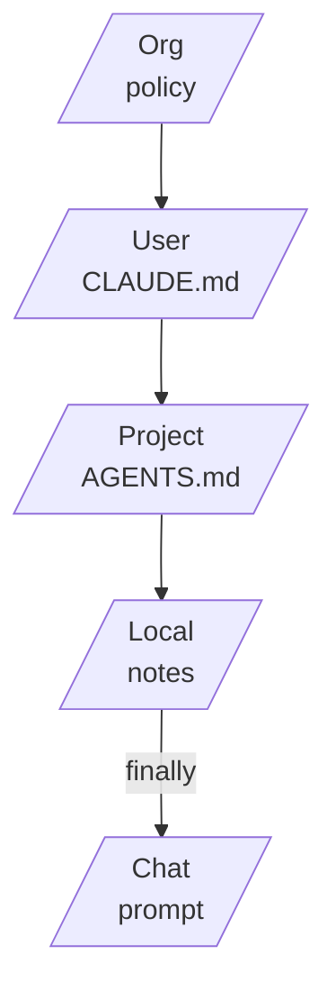

# Briefing Your Agent: AGENTS.md and CLAUDE.md

Every coding-agent session starts from zero. The model does not remember your stack, your test command, or the reason the billing module is weird. The only thing it knows is what the harness puts in front of it — and the one file that goes into *every* session is the briefing file: `AGENTS.md`, `CLAUDE.md`, or whatever your tool calls it.

That makes it the highest-leverage file in the repository, and the easiest one to ruin.

```callout
**In one sentence:** `AGENTS.md` is a short, always-loaded briefing that tells an agent what the project is, how to run it, and which conventions are non-negotiable — and it works only if you keep it small and current.
```

## A README for agents

The `AGENTS.md` project describes the format as "a README for agents: a dedicated, predictable place to provide the context and instructions to help AI coding agents work on your project." It is deliberately separate from `README.md` because build steps, test commands, and conventions would clutter a human-facing readme.

The format is intentionally boring: standard Markdown, no required fields, any headings you like. It is supported by Codex, Jules, Cursor, Copilot, Gemini CLI, Aider, Zed, Warp, opencode, and others — the site lists more than 60,000 open-source projects using it. It is now stewarded by the Agentic AI Foundation under the Linux Foundation.

A minimal example, adapted from the spec:

```markdown
# AGENTS.md

## Setup commands
- Install deps: `pnpm install`
- Start dev server: `pnpm dev`
- Run tests: `pnpm test`

## Code style
- TypeScript strict mode
- Single quotes, no semicolons
```

## What actually gets loaded

Different tools layer their instructions. Claude Code, for example, loads memory files in this order, from broadest to most specific:

1. **Managed policy** — organization-wide instructions deployed by IT.
2. **User instructions** — `~/.claude/CLAUDE.md`, your personal preferences across projects.
3. **Project instructions** — `./CLAUDE.md`, `./.claude/CLAUDE.md`, or `./AGENTS.md`, shared through version control.
4. **Local instructions** — `./CLAUDE.local.md`, your uncommitted, project-specific notes.



The files are concatenated, not replaced, and content closer to your working directory is read later. `AGENTS.md` adds one more rule: in a monorepo, the nearest file in the directory tree wins, so each package can ship tailored instructions. OpenAI's main repository reportedly has 88 of them.

## WHAT, WHY, HOW

HumanLayer's widely shared guide reduces the job to three questions:

- **WHAT** — the stack, the project structure, what each package is for. A map, especially in a monorepo.
- **WHY** — the purpose of the project and of its parts. The context an agent cannot infer from filenames.
- **HOW** — how to work here: `bun` instead of `node`, how to run tests, how to verify a change.

The `AGENTS.md` site's own sample covers the same ground: dev-environment tips, testing instructions, and PR conventions.

Anthropic's docs add a useful filter: write it down when the agent makes the same mistake twice, when review catches something it should have known, or when you type the same correction you typed last session. If a note is a multi-step procedure or only matters for one directory, it belongs in a skill or a path-scoped rule, not the always-loaded file.

## Write instructions you can verify

Anthropic's memory docs are blunt that these files are context, not enforced configuration. Vague rules get vague compliance. Their examples:

| Instead of | Write |
| --- | --- |
| "Format code properly" | "Use 2-space indentation" |
| "Test your changes" | "Run `npm test` before committing" |
| "Keep files organized" | "API handlers live in `src/api/handlers/`" |

The same principle appears in Anthropic's context-engineering guidance: aim for the "right altitude" — specific enough to steer, flexible enough not to encode brittle if-else logic in prose.

## The length trap

The instinct is to keep appending rules until the agent behaves. The evidence points the other way.

Anthropic recommends targeting **under 200 lines per file**, because longer files consume more context and reduce adherence. HumanLayer cites research suggesting frontier thinking models follow roughly 150–200 instructions with reasonable consistency, and that instruction-following degrades *uniformly* as instruction count rises — the model does not simply ignore the newest lines. Their root file is under 60 lines. They also argue that code style belongs in a linter, not a prompt: "Never send an LLM to do a linter's job."

This is why the same advice keeps recurring across practitioner write-ups: **less, but more universally applicable**. Every line in the file is paid for on every task, including the ones it has nothing to do with.

## Progressive disclosure

The alternative to a giant file is a small file that points at the right detail.

- **Path-scoped rules** — `.claude/rules/*.md` files can declare `paths: ["src/api/**/*.ts"]` and load only when matching files are opened.
- **Skills** — instructions, docs, and scripts that load on demand when relevant, instead of sitting in context all session.
- **Pointers over copies** — reference `file:line` or a document path rather than pasting code that will drift.

HumanLayer calls this progressive disclosure and recommends keeping task-specific docs in a separate `agent_docs/` folder, with the briefing file listing what exists and when to read it. Anthropic's context-engineering post makes the same move at the agent level: keep lightweight identifiers and retrieve just in time rather than preloading everything.

## Keeping it from rotting

The most common practitioner complaint is not that the file is missing — it is that it has become a museum of old hotfixes.

Recent r/ClaudeAI threads are explicit about this. One is titled "How I keep my CLAUDE.md from rotting: a discipline"; another tells readers "before you add more agents, fix your CLAUDE.md." The recurring advice in those discussions is unglamorous: prune regularly, delete rules that no longer change behaviour, and stop using the file as a scratchpad for every correction.

Anthropic now ships tooling for the same problem: `/doctor prompt-audit` checks instruction files for outdated references, contradictions, and instructions written for older models. Whether you use the command or do it by hand, the maintenance step is part of the practice.

## AGENTS.md vs CLAUDE.md

They are the same idea with different loading rules.

By default, Claude Code reads `AGENTS.md` only when there is no `CLAUDE.md` or `CLAUDE.local.md` in the working directory or above it. If a repository already standardises on `AGENTS.md`, Claude can use it directly (v2.1.277+), or you can keep one shared file with an import:

```markdown
@AGENTS.md

## Claude Code
Use plan mode for changes under `src/billing/`.
```

A symlink works too, with two caveats from the docs: the Edit and Write tools refuse to write through a symlink, and Windows needs Developer Mode or admin rights to create one. Prefer the import when either matters.

## What not to put in it

- **Secrets and tokens.** The file is committed and loaded into a third-party context.
- **Hard enforcement.** If something must happen every time, use a hook or a permission rule; the docs say instructions "shape Claude's behavior but are not a hard enforcement layer."
- **Procedures that only matter sometimes.** Move them to skills or scoped rules.
- **A copy of your style guide.** Use the formatter.

## A checklist

- Can a new teammate read it in two minutes?
- Does it name the exact install, dev, test, and lint commands?
- Does it explain the layout — what lives where, and why?
- Is every rule specific enough to verify?
- Is anything in it only relevant to one directory? Move it.
- Has anything become false since the last model upgrade?

## Glossary

- **AGENTS.md** — an open Markdown format for agent instructions, supported across coding tools.
- **CLAUDE.md** — Claude Code's project instruction file; `AGENTS.md` is read in its place when no `CLAUDE.md` exists.
- **Progressive disclosure** — loading detail on demand instead of up front.
- **Path-scoped rule** — an instruction file that loads only for matching paths.
- **Auto memory** — notes the agent writes for itself; in Claude Code the first 200 lines or 25 KB of `MEMORY.md` load each session.

## Wrapping up

The briefing file is not documentation for humans and not a prompt to be optimised once. It is a small, living contract: here is the project, here is how to run it, here is what will get your change rejected. Keep it short, make every line earn its place, and audit it when the agent starts drifting.

Next: [Context Engineering for Coding Agents](../tutorials/context-engineering-coding.md) — what to do when the briefing is fine but the session has filled up with noise.

## Sources

- [AGENTS.md](https://agents.md/) — format, examples, nesting rules, supported agents, stewardship.
- Anthropic, [How Claude remembers your project](https://code.claude.com/docs/en/memory) — load order, size guidance, path-scoped rules, imports, auto memory, auditing.
- HumanLayer, [Writing a good CLAUDE.md](https://www.humanlayer.dev/blog/writing-a-good-claude-md) — WHAT/WHY/HOW, instruction-count research, progressive disclosure, linter argument.
- Anthropic, [Effective context engineering for AI agents](https://www.anthropic.com/engineering/effective-context-engineering-for-ai-agents) — right altitude, just-in-time retrieval, progressive disclosure.
- r/ClaudeAI, ["How I keep my CLAUDE.md from rotting"](https://www.reddit.com/r/ClaudeAI/comments/1t6sz7m/how_i_keep_my_claudemd_from_rotting_a_discipline) and ["Before you add more agents, fix your CLAUDE.md"](https://www.reddit.com/r/ClaudeAI/comments/1sexheg/before_you_add_more_agents_fix_your_claudemd_its) — practitioner reports on rule accumulation.
- GitHub, [openai/codex AGENTS.md](https://github.com/openai/codex/blob/-/AGENTS.md) — a real-world example.
