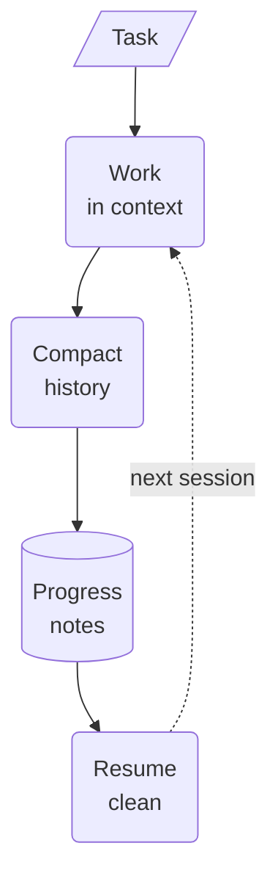

# Context Engineering for Coding Agents

A coding agent begins every session like an engineer arriving for a shift with no memory of the last one. It can read the repository, run commands, and search — but only within the context window you and the harness assemble. Everything it knows at the moment it writes code is in that window.

Context engineering is the practice of deciding what goes in.

```callout
**In one sentence:** context is a finite attention budget, not a storage bucket — curate the smallest set of high-signal tokens, retrieve the rest just in time, and compact deliberately before quality degrades.
```

## Prompt engineering was the warm-up

Anthropic frames context engineering as the natural successor to prompt engineering. Prompt engineering is about writing and organising instructions. Context engineering is about "curating and maintaining the optimal set of tokens (information) during LLM inference, including all the other information that may land there outside of the prompts" — system instructions, tools, MCP servers, retrieved data, and the entire message history.

For a one-shot classification task, the prompt is most of the job. For an agent working across dozens of turns, the prompt is a small part of a moving state.

## Context is a budget

Two findings drive the practice:

1. **Context rot.** As the number of tokens in the window grows, a model's ability to accurately recall information from that context decreases. Anthropic cites needle-in-a-haystack research showing this across models, with different rates of degradation.
2. **Attention is quadratic.** Transformer attention creates n² pairwise relationships for n tokens. Longer context stretches the model's ability to capture those relationships, and training data skews toward shorter sequences.

Anthropic's conclusion is that models have an "attention budget" and every token spends some of it. The goal is not maximum context. It is "the smallest possible set of high-signal tokens that maximize the likelihood of some desired outcome."

Martin Fowler's site puts the same idea in one line, quoting Bharani Subramaniam: "Context engineering is curating what the model sees so that you get a better result."

## What fills the window

HumanLayer's breakdown of context consumers in a coding session is concrete:

- searching for files
- understanding code flow
- applying edits
- test and build logs
- huge JSON blobs from tools

None of these are the task. They are the cost of doing the task. A session that spends 80% of its window on `grep` output and a stack trace has 20% left for the actual change.

## The smart zone and the dumb zone

Matt Pocock's widely shared workflow names the practical version of this. In a summary of his workshop, he describes two zones:

- **Smart zone** — fresh context, focused task, better decisions.
- **Dumb zone** — bloated context, reduced reliability, more mistakes.

He uses roughly **100K tokens** as a warning threshold, not a hard technical limit, and recommends breaking work into smaller independent tasks, keeping system instructions minimal, and preferring a clean restart over repeatedly compacting a long conversation.

That last point is the counter-intuitive one: compaction is a tool, not a strategy. If a session has gone bad, a new session with a better brief often beats salvaging it.

## Four levers

### 1. Start smaller

One task per session. A short brief. The rules that apply to *this* task, not every rule the project has ever needed.

This is why the previous tutorial's advice matters: a 400-line `AGENTS.md` is context spent before the agent reads a single file.

### 2. Retrieve just in time

Anthropic describes a shift from pre-loading everything to maintaining lightweight identifiers — file paths, queries, links — and loading them at runtime with tools. Claude Code uses a hybrid: `CLAUDE.md` is dropped in up front, while `glob` and `grep` let the agent navigate the codebase on demand, avoiding stale indexes.

For a coding session, that means:

- point at the relevant files instead of pasting them
- ask for a search rather than a summary of the whole repo
- let the agent read the test file it needs, not every test file

### 3. Compact deliberately

Compaction is summarising a conversation near the window limit and restarting with the summary. Anthropic's implementation preserves architectural decisions, unresolved bugs, and implementation details while discarding redundant tool output, then continues with the five most recently accessed files.

The cheapest form is **tool-result clearing**: once a tool result is deep in the history, the agent rarely needs the raw output again.

HumanLayer calls their version "frequent intentional compaction": design the whole workflow around context, keep utilisation in the **40–60%** range, and compact at natural boundaries rather than waiting for the window to overflow. Their compaction prompt asks for the end goal, the approach, the steps done, and the current failure. Commit messages can carry the same information.

### 4. Offload to notes and subagents

Two ways to keep working memory small:

**Structured notes.** The agent writes progress to a file outside the window and reads it back later. Anthropic compares it to a to-do list or a `NOTES.md`; in long-running harnesses it becomes a progress log that survives session boundaries.

**Subagents.** A subagent explores with its own clean window — tens of thousands of tokens if needed — and returns a condensed summary, often 1,000–2,000 tokens. The parent keeps the plan; the child keeps the mess. HumanLayer is blunt that subagents are "about context control," not role-play.



## The long-running harness

Anthropic's write-up on long-running agents is the clearest public example of context engineering as system design. The problem: an agent given "build a clone of claude.ai" will try to one-shot it, run out of context mid-feature, and leave the next session guessing.

Their fix has two parts:

1. **An initializer agent** sets up the environment: an `init.sh` script, a `claude-progress.txt` log, a feature list where every feature starts as failing, and an initial git commit.
2. **A coding agent** in every later session reads the progress file and git log, runs the app, verifies basic functionality, then implements exactly one feature and leaves a clean commit plus a progress update.

The feature list is JSON rather than Markdown because the model was less likely to rewrite it. Sessions start by getting their bearings — `pwd`, progress file, feature list, `git log`, `init.sh` — before touching code.

This is context engineering at the workflow level: the artifact, not the conversation, carries state.

## Research, plan, implement

HumanLayer's workflow applies the same logic to a single feature:

- **Research** — understand the relevant files, data flow, and likely cause.
- **Plan** — name the exact steps, files, and verification for each phase.
- **Implement** — work through the plan phase by phase, compacting status back into the plan after each verified phase.

Their argument for reviewing at the research and plan stages is leverage: "A bad line of code is a bad line of code. But a bad line of a plan could lead to hundreds of bad lines of code. And a bad line of research … could land you with thousands."

That is also why they call context engineering a craft rather than a prompt trick. In their account, the workflow made hard brownfield work possible, but only with deep human engagement and review at the cheap, high-leverage points.

## What good looks like

| Anti-pattern | Better move |
| --- | --- |
| One long session for a multi-part feature | One task per session, fresh brief |
| Pasting whole files and logs | Point at paths; let the agent read or grep |
| Waiting for the context bar to hit 100% | Compact at a natural boundary, around 40–60% utilisation |
| Asking the agent to remember decisions | Write them to a progress or plan file |
| Using a subagent as a persona | Use it to isolate search and return a short summary |
| Re-reading a failed session | Start clean with the compacted notes |

Böckeler adds a caution worth keeping: context configuration is not enforcement. The features "can definitely make a coding agent more effective," but execution still depends on how the model interprets the instructions. Treat the setup as a probability improvement, not a guarantee.

## Worked example

An engineer is chasing an intermittent total in `test/checkout.test.js` during a session that has already burned 92K tokens on grep output and CI logs.

**Input:** Before — three whole files and a 380-line CI log pasted into the prompt. After — the compact packet below.
**Output:** Context spend drops from ~46K tokens to ~400; the agent reads only the two files it needs, and `npm test -- test/checkout.test.js --runInBand` reproduces the failure in 2 of 40 runs.

```text
BEFORE  src/cart.ts (full) + src/checkout.ts (full) + test/checkout.test.js (full) + ci.log (380 lines)
AFTER   files: src/checkout.ts, test/checkout.test.js
        symptom: total 41.00, expected 42.50; fails in 2 of 40 runs
        command: npm test -- test/checkout.test.js --runInBand
        done: fix rounding in calculateTotal() and re-run that command
```

The packet is a pointer plus a test, not a copy of the repository — the move that keeps the agent in the smart zone.

## Glossary

- **Context window** — the tokens available to the model for one inference step.
- **Context rot** — degradation in recall as context length grows.
- **Compaction** — summarising history and continuing with the summary.
- **Just-in-time retrieval** — loading context through tools at the moment it is needed.
- **Subagent** — a separate agent with its own context window that returns a summary.
- **Smart zone / dumb zone** — Pocock's shorthand for fresh versus bloated context.

## Wrapping up

You cannot make the window bigger by wanting it. You can keep the task small, load only what matters, write state down before the window fills, and hand exploration to a context that gets thrown away. That is the whole discipline — and it is the difference between an agent that drifts for an hour and one that ships a focused change.

Next: [Spec-Driven Development with Spec Kit](../tutorials/spec-driven-development.md) — turning intent into an artifact the agent can work against.

## Sources

- Anthropic, [Effective context engineering for AI agents](https://www.anthropic.com/engineering/effective-context-engineering-for-ai-agents) — context rot, attention budget, right altitude, just-in-time retrieval, compaction, notes, subagents.
- Anthropic, [Effective harnesses for long-running agents](https://www.anthropic.com/engineering/effective-harnesses-for-long-running-agents) — initializer/coding agents, progress file, feature list, `init.sh`.
- Birgitta Böckeler, [Context Engineering for Coding Agents](https://martinfowler.com/articles/exploring-gen-ai/context-engineering-coding-agents.html), Martin Fowler site — context categories, context interfaces, size management, illusion of control.
- HumanLayer, [Advanced Context Engineering for Coding Agents](https://www.humanlayer.dev/blog/advanced-context-engineering) — frequent intentional compaction, 40–60% utilisation, research/plan/implement, subagents.
- Hansheng Li, [A Better Workflow for AI-Assisted Coding: Lessons from Matt Pocock](https://dev.to/lum_18/a-better-workflow-for-ai-assisted-coding-lessons-from-matt-pocock-143h) — smart/dumb zone, ~100K threshold, fresh context.
- Matt Pocock, [Full Walkthrough: Workflow for AI Coding](https://www.youtube.com/watch?v=-QFHIoCo-Ko) — the original workshop.
- r/ClaudeAI, ["Things I wish I knew earlier about Claude token usage"](https://www.reddit.com/r/ClaudeAI/comments/1t6asgc/things_i_wish_i_knew_earlier_about_claude_token) — practitioner discussion of context cost.
