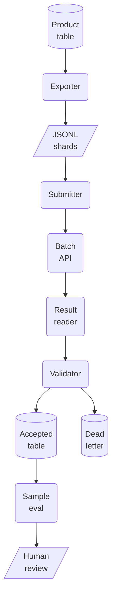

# Case Study: Batch Enrichment

Not every AI workload has a user watching. Some of the most valuable ones run at night, over millions of records, with a deadline measured in hours rather than milliseconds. The design constraints are almost the inverse of a chat product: latency barely matters, throughput and cost per record dominate, and the failure mode is silent bad data rather than a bad reply.

This case study applies the [design method](../tutorials/system-design-method.md) to a nightly enrichment job.

```callout
**In one sentence:** when nobody is waiting, optimise for cost per correct record — batch the calls, constrain the schema, make every step idempotent, and measure quality on a stratified sample every run.
```

## The situation

A marketplace has 2 million product records. Sellers write free-text descriptions; the catalogue team needs structured attributes: category, material, colour, size class, and a compliance flag for restricted goods.

Today, a team of eight annotators handles about 40,000 records a month. The backlog grows. The goal is to enrich all 2 million monthly, flag the uncertain 5% for human review, and keep the cost under a fixed budget.

The constraints:

- **Deadline:** finish within 24 hours of the nightly export.
- **Cost:** a fixed cost per 1,000 records, reviewed monthly.
- **Quality:** field-level accuracy measured against human labels; no silent regressions.
- **Audit:** every field must trace back to the model version, prompt version, and source record.
- **Safety:** descriptions are seller-written and therefore untrusted.

Nobody is waiting, which means the design can spend latency to buy cost and quality. That is the first decision.

## The architecture



Each stage is a separate job with its own retry policy:

| Stage | Responsibility | Failure behaviour |
| --- | --- | --- |
| Exporter | Select unenriched records, write JSONL | Re-run is safe; same IDs |
| Submitter | Upload and create batches | Idempotent by content hash |
| Result reader | Join results by `custom_id` | Re-read is safe |
| Validator | Schema plus business rules | Invalid goes to dead letter |
| Sample eval | Stratified human review | Blocks promotion if below bar |

The key property is that every stage can run twice without changing the outcome. That is what makes a 24-hour pipeline operable.

## Why batch, specifically

The Batch API is built for exactly this shape. OpenAI's documentation describes a 50% cost discount versus synchronous calls, a separate pool of higher rate limits, and a completion window of up to 24 hours. It is explicitly intended for jobs that do not need an immediate response: evaluations, classification of large datasets, and embedding repositories.

That matches this workload precisely. Three consequences follow:

- **You stop competing with interactive traffic for rate limits.** The batch pool is separate, so a nightly job does not degrade the product.
- **You accept a 24-hour tail.** A batch can end in `expired` if it does not finish in the window, and unfinished requests are cancelled. The pipeline must handle partial completion.
- **You pay for what ran.** Completed requests are charged even if the batch later expires, so retries need to be targeted, not a full resubmit.

If the requirement were "enrich this record when a seller saves it," batch would be wrong. The workload decides the API.

## The record contract

Every input line carries a stable `custom_id` and a body:

```json
{"custom_id":"prod_88412:v3","method":"POST","url":"/v1/responses","body":{"model":"your-model","input":[{"role":"system","content":"..."},{"role":"user","content":"..."}],"text":{"format":{"type":"json_schema","name":"attributes","strict":true,"schema":{"type":"object","properties":{"category":{"type":"string","enum":["apparel","electronics","home","beauty","other"]},"material":{"type":["string","null"]},"colour":{"type":["string","null"]},"size_class":{"type":["string","null"]},"restricted":{"type":"boolean"},"confidence":{"type":"number"}},"required":["category","material","colour","size_class","restricted","confidence"],"additionalProperties":false}}}}}
```

Three details are doing real work:

- **`custom_id` includes the record and the schema version.** Output order is not guaranteed to match input order, so the join must use the ID, not the line number.
- **The schema is closed.** Enums for category, `null` unions for genuinely optional fields, and `additionalProperties: false`. The validator can reject anything that does not fit.
- **There is a `confidence` field.** It is not a guarantee, but it gives the review queue a ranking signal.

The `confidence` value is model-reported, so calibrate it against human labels before trusting it. A useful pattern is to bucket by confidence and measure accuracy per bucket; if the top bucket is not clearly better, the score is decoration.

## Idempotency is the design

At 2 million records, a re-run that duplicates work is a budget incident. Three rules prevent it:

1. **Deterministic IDs.** `custom_id = record_id + ":" + schema_version`. The same record and schema always produce the same key.
2. **Content hash.** The submitter stores a hash of the prompt and schema per record. If the hash is unchanged and the record is already enriched, skip it.
3. **Upsert, not insert.** The accepted table is keyed by `record_id`; a second successful run overwrites rather than duplicates.

The pipeline also keeps a manifest per batch: batch ID, input file, record count, prompt version, model, and status. Without it, you cannot answer "which records came from the run that used the bad prompt?"

## Sharding and limits

Batch APIs impose per-batch limits — OpenAI's docs list up to 50,000 requests and a 200 MB input file per batch, with 2,000 batch creations per hour. Two million records therefore means roughly 40 batches at the request limit, and likely more at the size limit.

Shard by a stable key, not by export order. Product category is a good choice: it keeps similar records together, which helps with prompt caching and makes partial failures easier to reason about. Write one manifest per shard, and track completion per shard rather than per run.

## The cost model

The arithmetic is simple; the discipline is in the retry and cache terms.

```text
2,000,000 records
× 1.15 (retries and dead-letter reprocessing)
= 2,300,000 calls

per call: ~900 input tokens, ~120 output tokens
batch discount: 50%
```

Then:

- **Cache the shared prefix.** The system prompt, label definitions, and few-shot examples are identical across every record. A stable prefix turns most of the input into cache reads, which cost a fraction of fresh input tokens. The cache must be structured so the per-record text comes last; putting a timestamp or record ID before the static block defeats it.
- **Do not re-embed what has not changed.** If the pipeline uses embeddings for deduplication or retrieval, batch those separately and only for new records.
- **Escalate sparingly.** Send low-confidence records to a stronger model rather than running everything through it. A 5% escalation rate is a very different bill from 100%.

Convert the result to cost per 1,000 records and compare it to the human annotation cost. That is the number the budget owner cares about.

## Validation is the quality gate

Schema validity is necessary and nowhere near sufficient. The validator runs three layers:

| Layer | Checks | On failure |
| --- | --- | --- |
| Schema | Types, enums, required fields | Repair once, then dead letter |
| Business rules | Category and material compatibility, restricted-goods rules | Dead letter with reason |
| Distribution | Field mix vs the previous run, null rate, confidence mix | Alert; block promotion if shifted |

The distribution check catches the failure that schema validation cannot: a model that returns perfectly valid but systematically wrong labels. If `material` suddenly becomes `null` for 40% of apparel, the schema is happy and the catalogue is not.

A nightly sample closes the loop. Pull 300 records stratified by category and confidence bucket, have a human label them, and compute per-field accuracy. Store the result with the run manifest. A drop below the bar should stop the next promotion, not just send an alert nobody reads.

## Failure paths

| Failure | Detection | Response |
| --- | --- | --- |
| Batch expires | Status `expired` | Read completed results, resubmit only the unfinished IDs |
| Individual request fails | Error file entry | Retry once, then dead letter |
| Output order differs | Join by `custom_id` | Already handled by design |
| Schema invalid | Validator | One repair attempt, then dead letter |
| Duplicate submission | Content hash matches | Skip the record |
| Provider outage | Submit error | Back off and retry next window |
| Quality drift | Sample eval below bar | Block promotion; keep last good enrichment |
| Cost spike | Per-run budget alert | Cap records per run; investigate retries |

Two of these are easy to get wrong. Expired batches need a per-request resubmit, not a full re-run. And a failed batch should not block the accepted records from earlier shards; partial progress is the point of sharding.

## Rollout

1. **Pilot** on 10,000 records from one category. Compare against human labels.
2. **One category** in production, writing to a shadow table.
3. **All categories** with a 5% human review sample and promotion gated on the eval.
4. **Automate promotion** only after several runs hold the bar.

Keep the human annotators during the transition. They become the evaluation set and the review queue, which is a better use of their time than labelling everything.

## What changes at 10× volume

At 20 million records a month, three things change:

- **Orchestration moves into the warehouse.** Exporting to files and tracking manifests in application code stops scaling; a scheduler with lineage does not.
- **Model distillation becomes attractive.** A smaller model fine-tuned on the accepted labels can handle the easy majority, with the larger model only for the uncertain tail.
- **Quality sampling becomes statistical.** You cannot review 300 records and call it representative at that volume without stratification and confidence intervals.

The architecture holds. The operational tooling gets more serious.

## Common failure modes

| Symptom | Likely cause | Fix |
| --- | --- | --- |
| Duplicate enrichments | Re-run without content hashing | Deterministic IDs plus upsert |
| Half the batch missing | Expired window, full resubmit | Resume by `custom_id` from the error file |
| Valid JSON, wrong labels | No distribution or sample check | Add drift alerts and human review |
| Cost double the estimate | Retries, cache misses, no batch discount | Track retries per run; verify cache hits |
| Results joined to wrong records | Matching by output line order | Join by `custom_id` |
| Silent quality regression | Prompt or model changed without a gate | Version both; gate promotion on evals |
| Seller text triggers odd output | Untrusted input treated as instructions | No tools, constrained schema, validate output |

## A checklist

- Is this workload genuinely asynchronous?
- Does every request have a deterministic `custom_id`?
- Can every stage run twice without duplicating work?
- Is the schema closed, with enums and explicit nulls?
- Are shared instructions placed before per-record text for caching?
- Is there a validator beyond schema checking?
- Is quality measured on a stratified sample every run?
- Are prompt and model versions stored with the results?
- Does an expired batch resume only the unfinished requests?
- Is there a per-run cost cap and an alert?

## Worked example

The beauty-category shard submits 50,000 records at 21:00; the 24-hour window expires with 2,200 requests unfinished.

**Input:** manifest `beauty-v3`, 50,000 `custom_id`s, 47,800 completed results, 2,200 IDs in the error file.
**Output:** 2,200 resubmitted instead of 50,000; the accepted table holds at 47,800 rows with no duplicates.

```python
completed = {row["custom_id"] for row in read_results("beauty-v3.jsonl")}
requested = load_ids("beauty-v3.ids")
unfinished = requested - completed
submit_batch("beauty-v3-retry", [build_request(cid) for cid in sorted(unfinished)])
```

Only the unfinished IDs are charged again, because completed requests are billed even when the batch expires.

## Glossary

- **Batch API** — an asynchronous endpoint for large request sets, usually cheaper and slower than synchronous calls.
- **`custom_id`** — a caller-supplied identifier used to join results back to inputs.
- **Idempotent** — safe to run more than once with the same result.
- **Dead letter** — a queue for records that failed validation or retries.
- **Stratified sample** — a review sample drawn proportionally across categories.
- **Distribution drift** — a change in the mix of output values between runs.
- **Cache read** — input tokens served from a cached prefix at reduced cost.
- **Manifest** — the record of what ran, with which versions and inputs.

## Wrapping up

Batch enrichment is where AI engineering looks most like data engineering: idempotent stages, manifests, dead letters, and a quality sample. Choose batch pricing because nobody is waiting, constrain the output because the schema is your contract, and measure accuracy per field because valid JSON can still be wrong. The pipeline should be boring. Boring is what lets it run every night for a year.

## Sources

- OpenAI, [Batch API](https://platform.openai.com/docs/guides/batch) — 50% discount, separate rate limits, 24-hour window, 50,000 requests and 200 MB per batch, `custom_id` joins, expiration and billing behaviour.
- OpenAI, [Structured model outputs](https://platform.openai.com/docs/guides/structured-outputs) — JSON Schema constraints, required fields, refusals, and validation boundaries.
- Anthropic, [Prompt caching](https://platform.claude.com/docs/en/build-with-claude/prompt-caching) — cache reads at a fraction of input cost, prefix ordering, and invalidation rules.
- Sculley et al., [Hidden Technical Debt in Machine Learning Systems](https://papers.nips.cc/paper/2015/hash/86df7dcfd896fcaf2674f757a2463eba-Abstract.html), NeurIPS 2015 — pipeline jungles, configuration debt, and undeclared consumers.
