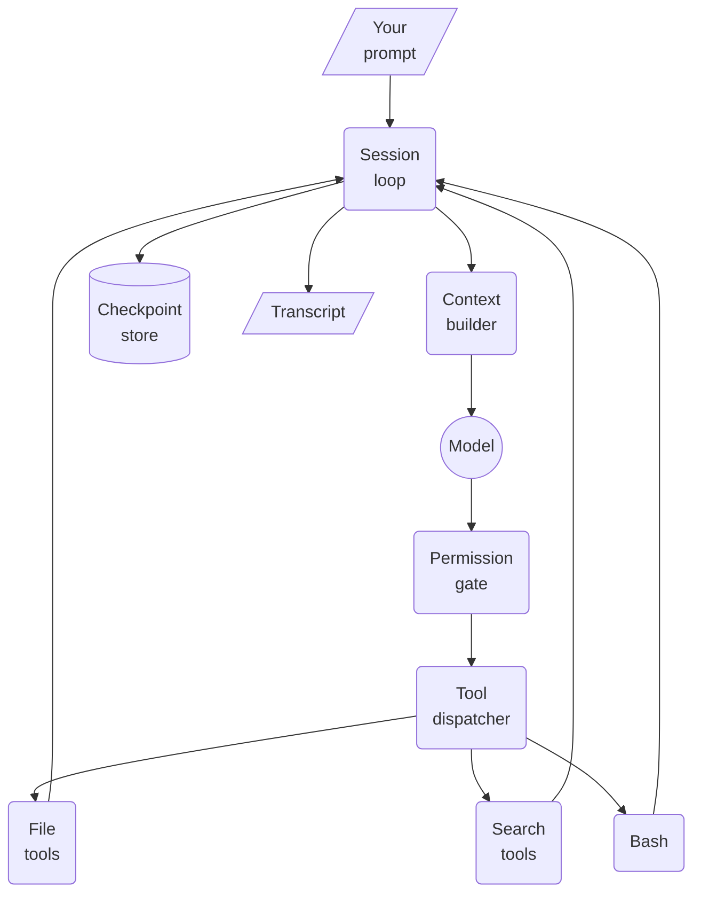

# Case Study: A Personal Coding Agent

Buying a coding agent is easy. Building one for yourself is a better design exercise, because the constraints are unusually honest: one user, a handful of real repositories, a fixed monthly budget, and a machine you would prefer not to wipe.

This case study designs a personal coding agent — a terminal tool in the spirit of Claude Code — using the [design method](../tutorials/system-design-method.md). The goal is not to clone a product. It is to understand which parts of the harness matter when the only customer is you.

```callout
**In one sentence:** a coding agent is an agentic loop wrapped in a harness — tools, context, permissions, and checkpoints — so design the harness, keep the toolset small, and let tests decide when the work is done.
```

## The situation

You work across four repositories: a web app, a CLI, a library, and a pile of scripts. You want an agent that can answer questions about the code, fix failing tests, make small features, review diffs, and write documentation.

The constraints:

- **Interactive.** You are watching, so first token under two seconds and streaming output matter.
- **Cheap.** A personal budget, say $30 a month. A runaway loop is a real cost.
- **Local.** It runs on your machine, against your working tree. No server, no auth, no multi-tenant anything.
- **Safe.** It can read everything in the repo. It can edit files with approval. It cannot push, delete, or reach the network without you saying so.
- **Verifiable.** Tests and linters are the source of truth, not the model's confidence.

That last constraint is the one that makes coding a good agent domain. Anthropic's own guidance notes that code is verifiable through automated tests, agents can iterate using test results as feedback, and output quality can be measured objectively. Use that.

## The architecture



The harness is everything around the model. Claude Code's docs describe it the same way: models reason, tools act, and the surrounding layer provides the tools and manages the context the model sees. That layer is the thing you are designing.

A session loop is the whole program:

```python
while not done:
    context = build_context(session, budget)
    reply = model(context, tools=TOOLS)
    for call in reply.tool_calls:
        if not permitted(call):
            result = denied(call)
        else:
            checkpoint(call)
            result = run_tool(call)
        session.append(result)
    done = stop_condition(session)
```

Everything hard about the agent lives inside `build_context`, `permitted`, and `stop_condition`.

## Keep the toolset small

The temptation is to expose everything: a shell, a browser, a database client, a deploy button. Resist it. Anthropic's context-engineering guidance calls bloated tool sets one of the most common failure modes, because overlapping tools create ambiguous choices — and if a human engineer cannot say which tool applies, the model cannot either.

A personal coding agent needs six tools:

| Tool | Purpose | Why it earns its place |
| --- | --- | --- |
| `read` | Read a file or a line range | The basic unit of context |
| `glob` | Find files by pattern | Cheap navigation without an index |
| `grep` | Search content | Finds the definition faster than reading |
| `edit` | Apply a diff to a file | Constrained writes, reviewable |
| `bash` | Run a command | Tests, git, build tools |
| `todo` | Maintain a task list | Keeps long tasks coherent |

That is close to the five categories Claude Code documents — file operations, search, execution, web, and code intelligence — minus the network. For a personal tool, leaving out web access removes a whole class of injection and exfiltration risk at almost no cost to daily work.

Two design rules keep the set usable:

- **No overlap.** If `grep` and `bash` can both search, the model will pick wrong. Make `grep` the way to search and reserve `bash` for execution.
- **Poka-yoke the arguments.** Anthropic's agents post describes changing a file tool to require absolute paths after relative paths caused errors. Make the wrong call hard, not merely discouraged.

## Context is the product

The model sees only what the harness assembles. Claude Code's own description of the loop is gather, act, verify, repeated — and most of the quality comes from what gets gathered.

A workable context budget for a personal agent:

| Component | Budget | Refresh |
| --- | --- | --- |
| System prompt | 1–2k tokens | Per release |
| `AGENTS.md` / `CLAUDE.md` | 1–3k tokens | Every session |
| Tool definitions | 1k tokens | Per release |
| Repo map or file tree | 1–2k tokens | Per session |
| Recent messages | 10–20k tokens | Every turn |
| Tool outputs | 5–10k tokens | Capped per call |
| Retrieved files | 20–40k tokens | Just in time |

The interesting choice is retrieval. You could embed the whole repository and search it, but a personal agent usually does better with just-in-time search. Anthropic's context-engineering post describes Claude Code as a hybrid: `CLAUDE.md` is loaded up front, while `glob` and `grep` let the agent navigate on demand, "effectively bypassing the issues of stale indexing and complex syntax trees."

That is the right trade for a small team of repositories. There is no index to rebuild, no embedding drift, and the agent sees the current working tree — including the uncommitted change you just made. The cost is latency: a grep takes longer than a vector lookup. For one user, that is acceptable.

## Compaction is not optional

A coding session generates enormous amounts of text: file contents, test output, stack traces, diffs. Even a large context window fills. Anthropic's guidance is blunt that model recall degrades as context grows — "context rot" — and that context should be treated as a finite resource with diminishing returns.

Three techniques, in increasing order of effort:

1. **Cap tool output.** Truncate long command output, show the first and last lines, and let the agent ask for more. This is the cheapest win.
2. **Clear old tool results.** Once a tool result is deep in the history, the agent rarely needs the raw output again. Anthropic calls tool-result clearing the lightest-touch form of compaction.
3. **Summarise and restart.** When the window fills, summarise the conversation, keeping architectural decisions, unresolved bugs, implementation details, and the files currently in play, then continue with that summary.

Claude Code's implementation keeps the five most recently accessed files alongside the summary. That is a good default: the summary carries the plan, the files carry the working set.

For multi-step tasks, add a notes file. Anthropic's post calls this structured note-taking: the agent writes progress to `NOTES.md` or a todo list, and reads it back after a reset. It is crude and remarkably effective. The [agent memory](../tutorials/agent-memory.md) tutorial covers the general version.

## Permissions and checkpoints

Two mechanisms, and they solve different problems.

**Permissions** decide what may happen. Mirror the four modes Claude Code exposes:

| Mode | Behaviour | When you use it |
| --- | --- | --- |
| Plan | Explore and propose, no edits | Unfamiliar code or risky changes |
| Manual | Ask before every edit and command | Default for a new repo |
| Accept edits | Edits and safe filesystem commands run | When you trust the task |
| Auto | A classifier blocks risky actions | Long sessions you are supervising |

For a personal agent, implement Manual and Plan first. Auto is a product feature, not a starting point.

**Checkpoints** decide what can be undone. Snapshot a file before editing it, keyed by session and path. This is separate from git: it covers the uncommitted state, and it works even when the repo is dirty. Claude Code does exactly this and exposes rewind on a double Escape.

Git is the second undo layer. Commit before a risky task, and the worst case is `git restore`.

Three rules make permissions trustworthy:

- **Show the diff, not a summary.** Approval must display the actual change.
- **Allowlist commands, not patterns.** `npm test` is fine; `npm *` is not.
- **Deny by default.** New commands and new paths require a decision.

## The safety model

A coding agent reads untrusted text all day: READMEs, issue bodies, dependency docs, error messages. Any of it can contain instructions. The [agent security](../tutorials/agent-security.md) tutorial covers the general problem; for a personal agent, four controls are enough to start:

- **No network by default.** Remove `curl`, `wget`, and browser tools unless the task needs them.
- **Scope the shell.** Run in the repo root, with a timeout, without `sudo`, and with an explicit deny list for destructive commands.
- **Keep secrets out.** Exclude `.env`, key files, and credential directories from reads; redact them from transcripts.
- **Gate irreversible actions.** `git push`, deploys, database migrations, and package publishes require confirmation every time.

The permission gate should be code, not a prompt. A rule that lives in a sentence can be argued with; a rule that lives in a function cannot.

## Tests are the stop condition

The agent needs a definition of done it cannot talk its way out of. For coding, that is:

1. The relevant tests pass.
2. The linter and type checker pass.
3. The diff is minimal and touches only the intended files.
4. No new dependency was added without approval.

Run the narrow test first, then the full suite. Feed failures back verbatim; do not summarise a stack trace before the model has seen it. Cap the retry loop — three attempts is usually enough before a human should look.

This is the evaluator-optimizer pattern from Anthropic's agent guidance, with the test suite as the evaluator. It works because the signal is external and objective.

## The cost model

A personal agent's bill is dominated by input tokens, because code is verbose. The levers:

```text
monthly cost =
  sessions × turns_per_session
  × (cached_input × cache_price + fresh_input × input_price + output × output_price)
  + retries
```

- **Cache the stable prefix.** System prompt, tool definitions, and `AGENTS.md` should be identical across turns. Cache reads cost a fraction of fresh input.
- **Route by task.** A small model can search, summarise, and classify. Reserve the expensive model for edits and planning.
- **Cap the loop.** Max turns, max tokens per task, max wall-clock time. A coding agent without a cap will happily spend your budget exploring.
- **Compact before you hit the limit.** Summarising at 80% is cheaper than a failed request and a retry.

Track cost per completed task, not per token. If a task costs $0.40 and saves twenty minutes, the token bill is irrelevant.

## Evaluate it on your own history

You have a ready-made benchmark: your git log. Take twenty past commits that fixed a bug or added a small feature. For each, check out the parent commit, give the agent the original commit message as the task, and see whether it produces a diff that passes the tests.

| Metric | What it tells you |
| --- | --- |
| Success rate | Share of tasks where tests pass and you accept the diff |
| Intervention rate | How often you had to steer or take over |
| Turns per task | Loop efficiency |
| Cost per task | Budget health |
| Time to green | Whether it is actually faster than doing it yourself |

Hold out five tasks you never inspect while tuning. Otherwise you will optimise the agent for the twenty commits you remember.

## Failure paths

| Failure | Detection | Response |
| --- | --- | --- |
| Context overflow | Token count near limit | Compact, keep recent files |
| Tests fail repeatedly | Attempt counter | Stop after three, show the diff |
| File changed on disk | Hash mismatch before edit | Re-read, then re-plan |
| Command hangs | Timeout | Kill the process, report |
| Destructive command | Deny list | Block and ask |
| Bad edit | You notice, or tests fail | Restore checkpoint |
| Provider error | HTTP status | Retry with backoff, then stop |
| Secret in output | Pattern match | Redact and warn |

The one to implement first is the checkpoint. Everything else is recoverable; a lost file is not.

## Rollout

1. **Read-only Q&A** on one repository. No tools beyond read, glob, and grep.
2. **Plan mode.** It proposes diffs; you apply them by hand.
3. **Edits with approval.** Checkpoints on, tests run manually.
4. **Allowlisted commands.** `npm test`, `git status`, `git diff`.
5. **Auto-run tests** after edits, still with approval for writes.

Do not skip to step five. The first four teach you where the agent is unreliable, and that knowledge is the actual product.

## What changes at team scale

A personal agent becomes a team platform when you add: authentication and per-user sessions, a remote sandbox instead of your laptop, shared policy and audit logs, cost attribution, and CI integration. The loop does not change. The harness grows a control plane.

That is also when the security model stops being optional. One user's prompt injection is an inconvenience; a shared agent with production credentials is an incident.

## Common failure modes

| Symptom | Likely cause | Fix |
| --- | --- | --- |
| Agent reads the whole repo | No search discipline | Prefer grep/glob; cap file reads |
| Quality drops mid-task | Context rot | Compact earlier; clear old tool output |
| Repeats the same failed fix | No attempt cap | Stop after three, surface the diff |
| Edits the wrong file | Stale view of the tree | Re-read before edit; hash check |
| Approval fatigue | Too many prompts | Allowlist safe commands; use plan mode |
| Bill spikes | No turn or token cap | Per-task budgets and alerts |
| Prompt injection from a README | Untrusted text treated as instructions | No network, gated actions, deny lists |
| Cannot undo | No checkpoint before edit | Snapshot every write |

## A checklist

- Is the toolset minimal, non-overlapping, and well described?
- Does the agent load persistent rules from `AGENTS.md` every session?
- Does it search just in time instead of relying on a stale index?
- Are tool outputs capped and old results cleared?
- Is there a compaction path that preserves decisions and the working set?
- Can you undo every file edit without git?
- Is the permission gate code rather than a prompt?
- Are destructive and network actions denied by default?
- Do tests define done, with a retry cap?
- Is there a per-task token and turn budget?
- Have you evaluated it on held-out commits from your own history?

## Worked example

You ask the personal agent to fix a failing test in the CLI repo; the session has a three-attempt cap and snapshots every edit.

**Input:** `pytest tests/test_invoice.py -q` reports 2 failed, 1 passed; file `src/parser.py`; task budget $0.40.
**Output:** two edits fail, attempt three still fails, and the loop stops with the diff shown and `src/parser.py` restored from its checkpoint.

```python
for attempt in range(1, 4):
    result = run_tool({"name": "bash", "command": "pytest tests/test_invoice.py -q"})
    session.append(result)
    if result["exit_code"] == 0:
        break
else:
    restore_checkpoint("src/parser.py")
    report(session.last_failure)
```

Tests decide done; the checkpoint makes a wrong third edit cheap to undo without touching git.

## Glossary

- **Harness** — the layer around the model that supplies tools and manages context.
- **Agentic loop** — gather context, act, verify, repeat.
- **Checkpoint** — a snapshot of a file before an edit, used for rewind.
- **Compaction** — summarising history to free context while keeping key state.
- **Just-in-time retrieval** — loading files on demand instead of indexing up front.
- **Permission mode** — the policy for what runs without approval.
- **Allowlist** — commands explicitly permitted to run unattended.
- **Context rot** — degraded recall as the context window fills.

## Wrapping up

A personal coding agent is a small program with four serious parts: a minimal toolset, a context builder that searches just in time, a permission gate backed by checkpoints, and tests as the stop condition. Get those right and the model becomes swappable. Get them wrong and a better model just makes bigger mistakes faster.

## Sources

- Claude Code docs, [How Claude Code works](https://code.claude.com/docs/en/how-claude-code-works) — the agentic loop, tool categories, sessions, context compaction, checkpoints, and permission modes.
- Anthropic, [Effective context engineering for AI agents](https://www.anthropic.com/engineering/effective-context-engineering-for-ai-agents), September 2025 — context rot, minimal toolsets, just-in-time retrieval, compaction, note-taking, and subagents.
- Anthropic, [Building effective agents](https://www.anthropic.com/engineering/building-effective-agents), December 2024 — evaluator-optimizer, tool design, and the case for the simplest architecture.
- Anthropic, [Writing effective tools for agents](https://www.anthropic.com/engineering/writing-tools-for-agents) — tool descriptions, non-overlapping tools, and token-efficient returns.
