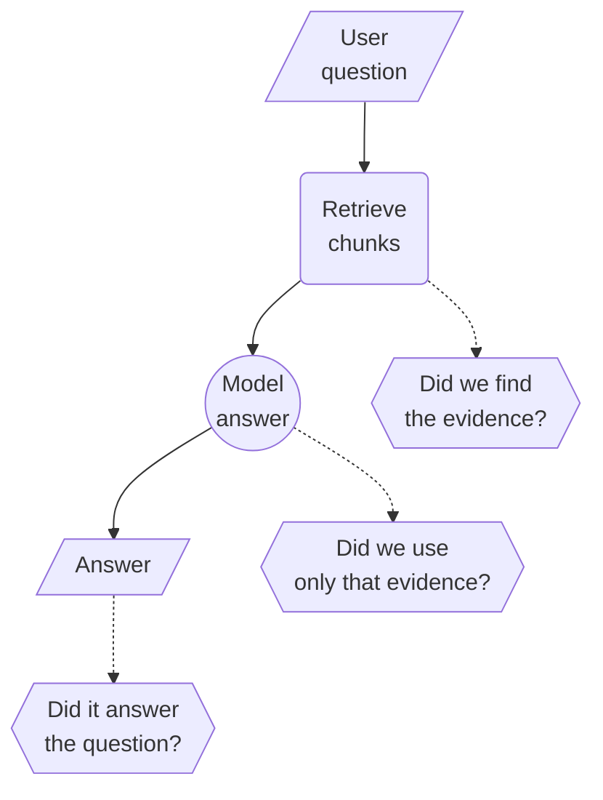

# Evaluating RAG Systems

"Accuracy is 94%." Ask how it was measured and the answer is usually: someone read twenty answers, liked eighteen of them, and rounded up. Then someone changes the chunk size, the embedding model, and the system prompt in the same afternoon. The score moves. Nobody knows which change helped.

Evaluating a RAG system is not one number. It is a set of measurements that localise failure: did retrieval find the evidence, did the model stick to that evidence, and did the answer actually resolve the user's question?

```callout
**In one sentence:** evaluate retrieval and generation as separate stages on a fixed dataset with known-good answers, then treat the end-to-end score as a trend line rather than a verdict.
```

## Three questions, three different measurements



The dotted lines are where the measurements attach. A bad answer can come from any one of them, and the fixes are completely different:

| Stage | Question | Typical fix when it fails |
| --- | --- | --- |
| Retrieval | Was the right passage in the top k? | Chunking, hybrid search, reranking |
| Grounding | Are the claims supported by those passages? | Prompt assembly, smaller context, stricter instructions |
| Answer | Does it address the user's actual question? | Prompt, model choice, clarification flow |

Collapsing these into one score is like measuring a car by how far it drove: true, but useless when it stops.

## Build the dataset first

A useful RAG dataset starts with real questions. Pull them from support tickets, search logs, or the questions your team keeps asking in Slack. Aim for 50–100 cases before you build a dashboard; that is enough to reveal patterns without becoming a maintenance project.

Each case should carry:

| Field | Why it exists |
| --- | --- |
| `user_input` | The question, with the phrasing users actually use |
| `reference` | A known-good answer, or at least the key facts it must contain |
| `reference_contexts` | The passages that should have been retrieved, with IDs |
| `metadata` | Topic, difficulty, language, tenant, and any other slice you will report on |
| `should_answer` | `false` for unanswerable questions — the abstention cases |

Include deliberately unanswerable questions. A system that confidently invents an answer to "what is our refund window for purchases made on Mars?" is not more helpful than one that says it does not know. The [golden dataset tutorial](../tutorials/eval-golden-datasets.md) covers coverage, negative cases, and keeping a dataset alive as the product grows.

Do not generate every question from the documents themselves. Synthetic question generation is a fine way to bootstrap, but it tends to produce questions that mirror chunk wording and flatters lexical retrieval. Keep a slice of human-written queries in the set permanently.

## Measure retrieval separately

Ragas defines two complementary retrieval metrics that are worth borrowing even if you do not adopt the framework.

**Context precision** asks whether relevant chunks were ranked above irrelevant ones. An irrelevant chunk at position 1 hurts the score; the same chunk at position 8 barely matters. This is a ranking metric.

**Context recall** asks how much of the reference answer's claims can be attributed to the retrieved context. It requires a reference. This is a coverage metric.

| Metric | High score means | Low score points to |
| --- | --- | --- |
| Context precision@5 | The useful chunks are near the top | Reranking, fusion weights, too much context |
| Context recall@5 | The evidence needed for the answer was retrieved | Chunking, embedding model, query rewriting |
| ID-based precision/recall | The right document IDs came back | A cheap deterministic check when IDs are stable |
| MRR / nDCG@k | Good results appear early on average | Ranking quality, usually for search-shaped products |

Add a deterministic ID-based check where you can. If every case maps to a known source document, comparing retrieved IDs is fast, free, and not subject to judge drift.

## Measure grounding

Faithfulness asks a narrow question: of the claims in the generated answer, how many are supported by the retrieved context?

```text
faithfulness = supported claims / total claims
```

An answer with two true statements and one invented date scores 0.5. That is more informative than "sounds plausible", and it catches the exact failure that matters in a grounded system. Ragas computes this by extracting claims and checking each one against the context.

```python
from ragas.llms import llm_factory
from ragas.metrics.collections import Faithfulness

scorer = Faithfulness(llm=llm_factory("your-eval-model", client=client))

result = await scorer.ascore(
    user_input=case["user_input"],
    response=answer,
    retrieved_contexts=chunks,
)
```

Faithfulness is not factuality against the world. If the source document is wrong, a faithful answer repeats the error. That is a content problem, not a generation problem.

**Answer relevancy** is the other useful generation-side metric. Ragas generates a few questions from the answer and measures the embedding similarity between those questions and the original question. It penalises incomplete and rambling answers without needing a reference. It does not check truth — pair it with faithfulness.

## The unanswerable case

The RGB benchmark from Chen et al. evaluates four abilities that RAG systems need: noise robustness, negative rejection, information integration, and counterfactual robustness. Their result is sobering: models showed some tolerance for noisy context but struggled with rejecting false premises and integrating information across passages.

Translate that into three extra metrics:

- **Abstention rate** — how often the system declines to answer when `should_answer` is false.
- **False-answer rate** — how often it invents an answer for those same cases. This should be near zero.
- **Counterfactual resistance** — whether a planted contradiction in a retrieved chunk changes the answer when the correct source is also present.

A 94% score that ignores unanswerable questions can hide a system that fabricates a quarter of the time.

## Make the judges trustworthy

LLM-based metrics are measurements with a measurement error. Treat them like instruments that need calibration.

| Risk | Control |
| --- | --- |
| Judge disagrees with humans | Label 30–50 cases by hand and measure agreement before trusting the metric |
| Judge drifts when its model changes | Pin the judge model and version; re-calibrate on upgrade |
| Judge rewards verbosity | Compare short and long correct answers in the calibration set |
| Score is noisy on one case | Run the judge twice and inspect disagreements, not just averages |
| Aggregate hides a broken slice | Report by topic, language, tenant, and difficulty |
| Judge prompt is itself a prompt | Version it like production code; see [LLM-as-Judge, Done Right](../tutorials/eval-llm-judge.md) |

Prefer deterministic checks where they work. Citation format, required fields, and "did the answer mention the right document ID?" are assertions, not judgments. Keep the LLM for the genuinely semantic parts.

A good harness records the raw artefacts alongside the scores: question, retrieved chunks with IDs, generated answer, each metric's value, and the judge's reasoning. Without the artefacts, a regression is just a number going down.

```python
async def evaluate_case(pipeline, scorers, case):
    answer, chunks = pipeline.ask(case["user_input"])

    score = {
        "faithfulness": await scorers["faithfulness"].ascore(
            user_input=case["user_input"],
            response=answer,
            retrieved_contexts=chunks,
        ),
        "answer_relevancy": await scorers["relevancy"].ascore(
            user_input=case["user_input"],
            response=answer,
        ),
    }

    return {"case": case, "answer": answer, "chunks": chunks, "score": score}
```

Run this on every prompt, model, or index change. The [eval harness tutorial](../tutorials/eval-harness-ci.md) shows how to turn it into a CI gate rather than a Friday afternoon ritual.

## Read the scores together

| Pattern | Likely diagnosis | Next move |
| --- | --- | --- |
| Low recall, high faithfulness | Evidence never reached the model | Fix retrieval, not the prompt |
| High recall, low faithfulness | Right context, model ignored or misused it | Shorten context, tighten prompt, change model |
| High faithfulness, low relevancy | Answer is grounded but off-topic | Prompt and intent handling |
| Low precision, good final answers | Context is noisy but model copes | Rerank to cut cost and latency |
| Good average, terrible one slice | Dataset is masking a subgroup | Split by metadata and fix that path |
| Scores fall after a model swap | Judge calibration may not transfer | Re-calibrate before concluding the model is worse |
| Fabrications on unanswerable cases | No abstention path | Add explicit "insufficient evidence" behaviour and test it |

A single table like this is worth more than a dashboard of disconnected averages.

## Common failure modes

| Symptom | Likely cause | Fix |
| --- | --- | --- |
| "Accuracy" jumps without explanation | Several changes landed at once | Change one variable per run; keep run metadata |
| Scores high, users unhappy | Dataset does not reflect real queries | Add live queries and feedback to the set |
| Judge scores everything 1.0 | Rubric too loose or judge sees the reference | Separate judge inputs; tighten criteria |
| Recall high but answers still wrong | Too much context diluting the evidence | Cut top-k; put the best chunks first |
| Evaluation bill larger than inference bill | LLM judges on every chunk of every case | Sample, cache judge results, use ID-based checks |
| Metrics stable for months | Dataset is stale | Review and refresh cases quarterly |
| Unanswerable cases score well | They were never in the dataset | Add negative cases with `should_answer: false` |

## A checklist

- Does the dataset contain real user phrasings, not only generated ones?
- Are reference answers or reference contexts recorded for every answerable case?
- Are unanswerable questions included with an abstention expectation?
- Are retrieval, grounding, and answer quality reported separately?
- Is there a deterministic ID-based check alongside the semantic metrics?
- Has the LLM judge been calibrated against human labels?
- Are the judge model, version, and prompt pinned?
- Are scores sliced by topic, language, and difficulty?
- Are the raw contexts and answers stored with every score?
- Can a failing case be promoted into the next regression run?

## Check yourself

```quiz
{
  "questions": [
    {
      "q": "Retrieved context contains the right passage at rank 8, plus three irrelevant chunks above it. Which metric is most directly concerned?",
      "options": ["Context recall", "Context precision", "Faithfulness", "Answer relevancy"],
      "answer": 1,
      "why": "Context precision measures whether relevant chunks are ranked above irrelevant ones; recall only asks whether the evidence was retrieved at all."
    },
    {
      "q": "A RAG answer is fully supported by the retrieved context, but the source document itself contains a wrong date. What does that say about the pipeline?",
      "options": ["The faithfulness metric is broken", "The model hallucinated the date", "Generation was faithful; the problem lies in the source content", "Context recall is too low"],
      "answer": 2,
      "why": "Faithfulness measures support by the retrieved context, not truth against the world."
    }
  ]
}
```

## Worked example

A team swaps 512-token chunks for 256-token chunks and sees overall faithfulness rise from 0.81 to 0.83; they need to decide whether to promote it.

**Input:** 120 cases — 80 English, 40 Spanish — with stored runs `v3-512` and `v4-256` and per-case `context_recall` and `faithfulness`.
**Output:** English faithfulness 0.84→0.88, Spanish 0.74→0.62; Spanish recall 0.71→0.52, so promotion is blocked.

```python
def slice_delta(before, after, field, lang):
    a = [r[field] for r in before if r["language"] == lang]
    b = [r[field] for r in after if r["language"] == lang]
    return round(sum(b) / len(b) - sum(a) / len(a), 3)

recall_change = slice_delta(runs["v3-512"], runs["v4-256"], "context_recall", "es")
promote = recall_change >= 0
```

The aggregate improvement hid a retrieval regression: smaller chunks pushed the Spanish evidence out of the top 5, so the fix belongs in retrieval, not the prompt.

## Glossary

- **Context precision** — whether relevant chunks are ranked higher than irrelevant ones.
- **Context recall** — whether the retrieved context covers the claims needed for the answer.
- **Faithfulness** — the fraction of answer claims supported by the retrieved context.
- **Answer relevancy** — how well the answer addresses the question, ignoring factual accuracy.
- **Reference context** — the passage known to contain the answer, used as an evaluation label.
- **Abstention** — declining to answer when the evidence is insufficient.
- **Judge calibration** — measuring an LLM evaluator's agreement with human labels before trusting its scores.
- **Slice** — a subset of the dataset sharing metadata, such as language or topic.

## Wrapping up

Good RAG evaluation is mostly good bookkeeping: a fixed dataset with real queries and known evidence, separate measurements for retrieval and generation, calibrated judges, and raw artefacts you can inspect. Score each stage, slice the results, and keep the failures. Those are the cases that make the next version better.

## Sources

- Es, S., James, J., Espinosa-Anke, L., & Schockaert, S., [Ragas: Automated Evaluation of Retrieval Augmented Generation](https://arxiv.org/abs/2309.15217), 2023 (revised 2025) — reference-free, multi-dimensional RAG evaluation.
- Ragas documentation, [Available metrics](https://docs.ragas.io/en/stable/concepts/metrics/available_metrics/) and [Faithfulness](https://docs.ragas.io/en/stable/concepts/metrics/available_metrics/faithfulness/) — metric definitions, formulas, and current API usage.
- Chen, J., Lin, H., Han, X., & Sun, L., [Benchmarking Large Language Models in Retrieval-Augmented Generation](https://arxiv.org/abs/2309.01431), AAAI 2024 — the RGB benchmark and its four evaluation testbeds.
