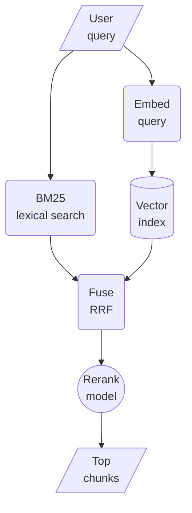

# Hybrid Search and Reranking

A user asks: "What happens when the API returns 429 and retries are exhausted?" The answer is in your docs. The embedding search finds a lovely passage about graceful degradation and nothing about status code 429. A keyword search finds the exact error code in a troubleshooting table buried on page four. Neither result set alone would have answered the question.

This is the ordinary failure of a single retrieval method. Lexical search is precise but literal. Dense search is flexible but fuzzy. Hybrid search runs both, fuses the rankings, and then a reranker reads the shortlist properly before you hand anything to the model.

```callout
**In one sentence:** retrieve broadly with lexical and dense search, fuse by rank rather than score, and spend a reranker only on the top few dozen candidates — recall first, precision second.
```

## Why one retriever is never enough

| Query type | Lexical (BM25) | Dense (embeddings) |
| --- | --- | --- |
| Exact code, SKU, error string, person's name | Strong | Often misses rare tokens entirely |
| Paraphrase — "retry limit" vs. "retries are exhausted" | Weak | Strong |
| Acronyms with no expansion | Depends on the corpus | Depends on training data |
| Out-of-domain jargon | Strong if the term appears | Can drift to a plausible neighbour |
| Short, ambiguous queries | Brittle | Usually better |

The two failure sets barely overlap. That is the whole argument for running both.



## Layer 1: lexical search

BM25 ranks documents by term overlap with three adjustments that matter in practice:

- **Term frequency saturation.** Repeating a word ten times does not make a document ten times more relevant. The gain flattens out.
- **Inverse document frequency.** A rare term like `429` counts for far more than a common one like `error`.
- **Length normalisation.** A 2,000-word page is not automatically better than a 200-word paragraph just because it contains the term more often.

The usual tuning knobs are `k1` (how quickly term frequency saturates, often around 1.2) and `b` (how strongly document length is penalised, often around 0.75). Leave them alone until you have a dataset that says otherwise.

BM25 is cheap, exact, and excellent at identifiers. It is the first thing to try when a query contains a string a human would put in quotation marks.

## Layer 2: dense retrieval

Dense retrieval embeds the query and the chunks into the same vector space, then finds nearest neighbours — usually with an approximate nearest-neighbour index such as HNSW.

Two practical notes:

- **ANN is approximate.** `ef`/`num_candidates` style knobs trade latency for recall. A retrieval evaluation will tell you whether you are losing the right chunk inside the index before the reranker ever sees it.
- **The embedding model is a ceiling.** If the model has no notion that "retries are exhausted" relates to "retry limit", no amount of index tuning will recover the passage. Chunking quality matters too; see the [RAG pipeline tutorial](../tutorials/rag.md).

Dense retrieval wins on paraphrase and conceptual similarity. It loses on exact tokens, especially rare ones the embedding model had no reason to encode.

## Layer 3: fusion with reciprocal rank fusion

Do not try to compare a BM25 score of `11.4` with a cosine similarity of `0.82`. The scales are unrelated, and a weighted sum becomes a weighting problem you now have to own.

Reciprocal rank fusion (RRF) ignores scores and uses positions:

```text
rrf_score(d) = Σ_over_lists  1 / (k + rank_in_list(d))
```

Ranks start at 1, and `k` is a small constant — Elasticsearch defaults to `60`. A smaller `k` gives top-ranked results more influence. The method needs no training and no score calibration, which is why it became the default fusion trick.

Worked example with `k = 60`:

| Chunk | BM25 rank | Dense rank | RRF score |
| --- | --- | --- | --- |
| A — troubleshooting table | 1 | 2 | 1/61 + 1/62 = 0.0325 |
| B — retry policy prose | 3 | 1 | 1/63 + 1/61 = 0.0323 |
| C — rate-limit overview | 2 | — | 1/62 = 0.0161 |
| D — graph of graceful degradation | — | 3 | 1/63 = 0.0159 |

A and B are nearly tied, which is exactly the point: fusion cannot tell which one actually answers the question. That is the reranker's job.

```python
def reciprocal_rank_fusion(rankings, k=60):
    scores = {}
    for ranking in rankings:
        for rank, doc_id in enumerate(ranking, start=1):
            scores[doc_id] = scores.get(doc_id, 0.0) + 1 / (k + rank)
    return sorted(scores, key=scores.get, reverse=True)
```

Fetch a wider window from each retriever than you plan to keep. Fusing the top 5 of each list cannot surface a document that ranked 12th lexically and 3rd densely.

## Layer 4: reranking

A reranker — usually a cross-encoder — takes a query and one candidate at a time and scores the pair jointly. Instead of comparing two independently computed vectors, it lets attention look at the query tokens while reading the passage. Nogueira and Cho's 2019 BERT reranking work was a historical demonstration of how large this gain can be: they reported a 27% relative improvement in MRR@10 over the then-previous state of the art on MS MARCO passage retrieval. Treat that as evidence for the technique, not a promise for your corpus.

The cost is linear in the number of candidates. Rerank 20–200 fused chunks, not 20,000.

```python
import cohere

co = cohere.ClientV2()

query = "What happens when the API returns 429 and retries are exhausted?"
candidates = fetch_fused_chunks(query, limit=50)

results = co.rerank(
    model="rerank-v5.0-pro",
    query=query,
    documents=[chunk["text"] for chunk in candidates],
    top_n=5,
)

top_chunks = [candidates[hit.index] for hit in results.results]
```

Cohere's response returns the original document `index` and a relevance score. The `index` is what you use to map back to your chunk; the score is useful for thresholds and debugging, not as a universal probability.

If you already have a suitable local model, a Hugging Face cross-encoder works the same way. The architectural point is unchanged: a slow, accurate model on a short list.

## When to add each layer

| Situation | Start with | Add next |
| --- | --- | --- |
| Small, clean corpus; natural-language questions | Dense only | Lexical if exact identifiers matter |
| Support docs, code, product catalogues | Lexical + dense fusion | Reranker for answer quality |
| Latency budget under ~200 ms | Lexical + tuned ANN | Rerank only when confidence is low |
| Legal or medical retrieval, high recall requirement | Wide fusion window | Reranker plus manual review of low scores |
| Retrieval quality already measures well | Leave it alone | Spend the effort on generation or chunking |

Adding layers is not free. Each one adds latency, a failure mode, and something to monitor. Measure first.

## Evaluate each layer separately

A single end-to-end score will not tell you where the failure is.

| Question | Metric to track |
| --- | --- |
| Did the right chunk exist in the index? | Corpus recall, chunking audit |
| Did the retrievers find it? | recall@k, MRR@k, nDCG@k |
| Did fusion keep it near the top? | recall after fusion vs. per-retriever |
| Did the reranker promote it? | precision@5, score distribution |
| Did the answer use it faithfully? | Faithfulness, citation accuracy |
| Did the whole thing stay within budget? | p95 latency, cost per query |

The [RAG evaluation tutorial](../tutorials/evaluating-rag.md) covers the dataset and the generation-side metrics. The architectural rule here is simpler: record the candidate list at each stage. If you only log the final context, you cannot tell whether a bad answer came from a missing chunk, a bad fusion, or a bad rerank.

## Common failure modes

| Symptom | Likely cause | Fix |
| --- | --- | --- |
| Exact identifiers never retrieved | Dense-only retrieval | Add BM25 for the lexical layer |
| Paraphrased questions fail | Lexical-only retrieval | Add dense retrieval |
| Fusion makes results worse | Fusing tiny top-k lists | Widen each retriever's candidate window |
| Scores look incomparable | Adding weighted raw scores | Fuse by rank with RRF |
| Reranker is too slow | Reranking the whole corpus | Rerank the fused top 50 only |
| Good chunks ranked low | Wrong chunk size or embedding model | Fix chunking; evaluate the embedding model |
| Reranker likes long passages | Verbosity bias in the model | Normalise chunk lengths; calibrate on labelled pairs |
| Quality improved but latency doubled | Too many layers on every query | Trigger the reranker only on low-confidence retrievals |

## A checklist

- Does the corpus contain queries with exact identifiers as well as paraphrases?
- Are both retrievers returning a candidate window wider than the final context size?
- Is fusion using ranks rather than raw scores?
- Is the reranker applied only to a short fused list?
- Do you log candidates before fusion, after fusion, and after reranking?
- Is recall@k measured independently of answer quality?
- Is p95 latency and cost per query still inside the product's budget?
- Has the reranker been checked on labelled pairs from this domain, not just a public leaderboard?

## Check yourself

```quiz
{
  "questions": [
    {
      "q": "Why does reciprocal rank fusion avoid comparing BM25 and vector scores directly?",
      "options": ["It converts both to probabilities", "It ranks by position in each list and ignores the raw scores", "It trains a linear weight on the two scores", "It discards one of the result lists"],
      "answer": 1,
      "why": "RRF sums 1/(k + rank) for each list, so incomparable score scales never enter the calculation."
    },
    {
      "q": "Where should a cross-encoder reranker sit in the pipeline?",
      "options": ["Before indexing, on every chunk", "On every vector search candidate", "On the short fused shortlist", "After the LLM has generated the answer"],
      "answer": 2,
      "why": "Cross-encoders are accurate but slow, so they are applied to the top few dozen fused candidates."
    }
  ]
}
```

## Worked example

A developer searches the docs for "ERR_429 retry limit exhausted"; the only correct passage sits at BM25 rank 12 and dense rank 3, outside both top-5 lists.

**Input:** query `ERR_429 retry limit exhausted`, `k=60`, fused window 50, reranker top 5; retriever window 5 before and 20 after.
**Output:** before — the passage is absent from the final 5; after — it enters the fused top 8 and lands at final position 2.

- Condition: BM25 rank 12 > window 5 → outcome: the lexical list drops the passage.
- Condition: dense rank 3 ≤ window 20 → outcome: fusion scores it 1/72 + 1/63 = 0.0298.
- Condition: fused rank 8 ≤ 50 → outcome: the cross-encoder sees it.
- Condition: pair score 0.91 vs the leader's 0.94 → outcome: final position 2.

## Glossary

- **BM25** — a lexical ranking function based on term frequency, inverse document frequency, and document length.
- **Dense retrieval** — finding chunks by vector similarity to the query embedding.
- **ANN** — approximate nearest neighbour search, trading a little recall for much lower latency.
- **Fusion** — combining several ranked lists into one.
- **RRF** — reciprocal rank fusion, `Σ 1/(k + rank)` across result lists.
- **Cross-encoder** — a model that scores a query–passage pair jointly, rather than comparing separate embeddings.
- **Recall@k** — the fraction of known relevant chunks that appear in the top k results.
- **Candidate window** — how many results each retriever returns before fusion.

## Wrapping up

Start by asking what your queries actually look like. Exact strings need lexical search; paraphrases need dense search; most real systems need both. Fuse by rank, rerank a short list, and log the candidates at every stage. The model at the end can only reason over what retrieval put in front of it.

## Sources

- Robertson, S., & Zaragoza, H., *The Probabilistic Relevance Framework: BM25 and Beyond*, 2009, DOI `10.1561/1500000019` — the definitive treatment of BM25; see the [BM25 overview](https://en.wikipedia.org/wiki/Okapi_BM25) for a short summary of the scoring terms.
- Cormack, G. V., Clarke, C. L. A., & Buettcher, S., [Reciprocal Rank Fusion Outperforms Condorcet and Individual Rank Learning Methods](https://plg.uwaterloo.ca/~gvcormac/cormacksigir09-rrf.pdf), SIGIR 2009, DOI `10.1145/1571941.1572114` — the original RRF paper.
- Nogueira, R., & Cho, K., [Passage Re-ranking with BERT](https://arxiv.org/abs/1901.04085), 2019 — cross-encoder reranking and the MS MARCO result.
- Elasticsearch, [Reciprocal rank fusion](https://www.elastic.co/docs/reference/elasticsearch/rest-apis/reciprocal-rank-fusion) — formula, defaults, and a worked BM25-plus-kNN example.
- Cohere, [An overview of Cohere's Rerank model](https://docs.cohere.com/docs/reranking) — request shape, returned indices, and relevance scores.
