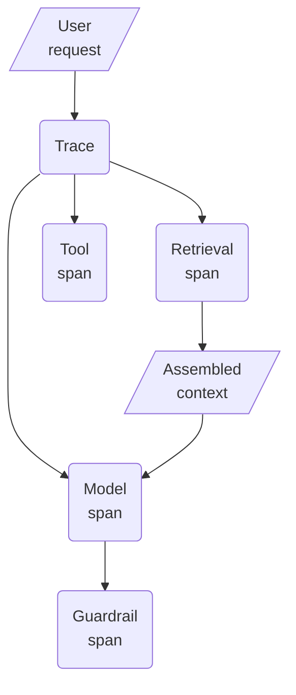

# LLM Observability

A user reports that the assistant "gave a weird answer yesterday, around lunch." You open the logs and find a 200, a request ID, and 4.2 seconds of latency. No prompt, no retrieved chunks, no tool calls, no model version. You cannot reproduce it, because you cannot see it.

That gap is what observability closes. For an LLM application, the unit of debugging is not a log line. It is a trace: the full tree of what went in, what the model did, what it retrieved, what it called, and what came out.

```callout
**In one sentence:** instrument every request as a trace with nested spans for retrieval, model calls, and tools — because "the model was bad" is almost never the whole story, and without a trace you cannot find the part that was.
```

## What a trace contains

A trace is one end-to-end request. Inside it, each meaningful step is a span with a start, an end, and attributes. For an LLM app, the useful shape is usually:

- **Request span** — the user turn, session, and application version.
- **Retrieval span** — query, filters, number of chunks, scores, which documents came back.
- **Model span** — provider, model, prompt, response, token counts, finish reason.
- **Tool span** — tool name, arguments, result, error, duration.
- **Guardrail span** — checks run, verdicts, and whether they changed the output.

The point is not to log everything. It is to be able to answer: which step produced the bad output, and what did it see?



Nesting matters. If retrieval and the model call are siblings with no shared parent, you cannot tell which chunks were in the prompt that produced the answer.

## Use the standard, not a private format

OpenTelemetry's GenAI semantic conventions define how to describe model calls, agents, tools, retrieval, and MCP in traces and metrics. They are still in **Development** status, and names have moved — the conventions now live in a separate repository, and older instrumentation may emit `gen_ai.system` where the current name is `gen_ai.provider.name`. Expect churn, but adopt the shape anyway: a standard schema means your traces survive a vendor switch.

Attributes worth setting on a model span:

| Attribute | Meaning |
| --- | --- |
| `gen_ai.operation.name` | The operation, such as `chat` |
| `gen_ai.provider.name` | The provider |
| `gen_ai.request.model` | The requested model |
| `gen_ai.response.model` | The model that actually served it |
| `gen_ai.usage.input_tokens` | Prompt tokens |
| `gen_ai.usage.output_tokens` | Completion tokens, including reasoning |
| `gen_ai.conversation.id` | Groups turns into a session |
| `gen_ai.input.messages` / `gen_ai.output.messages` | Content, subject to your redaction policy |

That last row is the one to think about before enabling it. Message content is the most useful data and the most sensitive.

```python
from opentelemetry import trace

tracer = trace.get_tracer("support-agent")

with tracer.start_as_current_span("chat") as span:
    span.set_attribute("gen_ai.operation.name", "chat")
    span.set_attribute("gen_ai.provider.name", "openai")
    span.set_attribute("gen_ai.request.model", MODEL)
    span.set_attribute("gen_ai.conversation.id", conversation_id)

    response = client.responses.create(model=MODEL, input=messages)

    span.set_attribute("gen_ai.usage.input_tokens", response.usage.input_tokens)
    span.set_attribute("gen_ai.usage.output_tokens", response.usage.output_tokens)
```

Instrument the framework you use if it already emits these spans — most agent frameworks and gateways do — and add manual spans only for the steps they miss, usually retrieval and business logic.

## Sample traces, not spans

Sampling individual spans destroys traces. If retrieval is sampled out and the model call is not, you have a record that proves nothing. Sample at the trace level, and use tail sampling when you can: decide after the request finishes, so you can keep all errors, all slow requests, and all expensive ones while dropping the boring successes.

A workable starting policy:

- Keep 100% of errors, refusals, and guardrail trips.
- Keep 100% of requests above a latency or cost threshold.
- Sample the rest at 5–20%.
- Always keep the full trace, never a random subset of its spans.

For high-volume systems, store full content only for kept traces and aggregate metrics for everything else. Metrics tell you that something is wrong; traces tell you what.

## Metrics that actually get used

| Metric | Why it matters |
| --- | --- |
| p50 / p95 latency | Averages hide the tail users feel |
| Time to first token | The number that decides whether streaming feels fast |
| Tokens per request | Cost driver and context-pressure signal |
| Cost per request | Attribute it by feature and tenant |
| Error and timeout rate | Provider health and your own retry logic |
| Refusal rate | Prompt or safety changes show up here first |
| Tool error rate | Distinguishes a bad model from a broken tool |
| Cache hit rate | Prompt caching is either working or silently not |
| Retrieval hit rate | Empty or irrelevant retrieval looks like a model failure |

Break these down by model version, prompt version, and feature. A single aggregate latency number will hide the one endpoint that regressed.

## Privacy is part of the design

Prompts contain user data, and traces multiply it. Decide before you turn on content capture:

- **Redact at the boundary.** Strip emails, phone numbers, tokens, and account identifiers before export.
- **Hash identifiers.** Keep a stable hash for correlation, not the raw value.
- **Set retention.** Thirty days is a common default; some data needs hours.
- **Control access.** Traces are production data and should be treated like it.
- **Self-host when required.** Open-source options such as Langfuse can run in your own infrastructure, which is often the deciding factor for regulated workloads.

A trace store is a new copy of your users' data. Treat it as one.

## Close the loop with evaluation

Observability tells you what happened; evaluation tells you whether it was good. The useful bridge is turning production traces into test cases.

- Attach user feedback as a score on the trace.
- Promote failing traces into a dataset.
- Replay the dataset against a new prompt or model.
- Compare pass rates before shipping.

Langfuse's docs frame this directly: observability gives your evaluations "real production traces to run on," so you are measuring against real failures instead of invented ones. The [golden datasets](../tutorials/eval-golden-datasets.md) and [LLM-as-judge](../tutorials/eval-llm-judge.md) tutorials cover the evaluation side.

## Debugging with a trace

| Symptom | Span to inspect first |
| --- | --- |
| Answer ignores a document | Retrieval: was the chunk there, and what score? |
| Answer cites the wrong source | Retrieval and prompt assembly |
| Tool never runs | Model span: was the tool offered and chosen? |
| Tool runs with bad arguments | Tool span arguments and the model's reasoning |
| Slow but tokens are low | Queueing, provider latency, or a slow tool |
| Cost spike with flat traffic | Reasoning tokens, retries, or a longer prompt |
| Output blocked unexpectedly | Guardrail span and its verdict |
| Different answers for the same input | Model version, temperature, or changed retrieval |

This table is the practical payoff. Without spans, every row collapses into "the model was weird."

## Common failure modes

| Symptom | Likely cause | Fix |
| --- | --- | --- |
| Traces missing steps | Framework not instrumented, or spans sampled independently | Add manual spans; sample at trace level |
| Prompts absent from traces | Content capture disabled for privacy | Capture redacted content for kept traces |
| Cannot reproduce a bad answer | Model version or prompt version not recorded | Attach both as attributes |
| Cost reports disagree with the bill | Cached and reasoning tokens not counted | Use provider usage fields, not estimates |
| Trace volume explodes | Logging every token of every request | Tail sampling plus metrics |
| Sensitive data in the trace store | No redaction at export | Redact before the exporter runs |
| Sessions impossible to follow | No conversation or user identifier | Propagate a session ID across turns |

## A checklist

- Does one user request produce one trace with nested spans?
- Are retrieval, model, tool, and guardrail steps all represented?
- Do model spans record provider, requested model, and served model?
- Are input, output, cached, and reasoning tokens captured separately?
- Is sampling done per trace, with errors and slow requests always kept?
- Is content redacted before it leaves the process?
- Is there a retention policy and access control on the trace store?
- Can a failing trace be promoted into an evaluation dataset?
- Are latency and cost broken down by prompt and model version?

## Worked example

A support lead investigates a "weird answer" complaint from 12:14 on 2026-11-18 using the nested spans the support agent already exports.

**Input:** Trace `4bf92f10` for "Where is my refund?" — model span `gen_ai.response.model=gpt-4o-2026-03-01`, `output_tokens=142`; retrieval span `chunks=0` with filter `tenant=acme-corp`.
**Output:** Root cause is empty retrieval, not the model; after normalizing the filter to `acme`, the trace records `chunks=3` and the answer cites the refund policy.

- **IF** the retrieval span reports `chunks = 0` **THEN** inspect filters before the model span — the answer came from parametric memory.
- **IF** `gen_ai.request.model` differs from `gen_ai.response.model` **THEN** blame routing or a version bump, not the prompt.
- **IF** the `get_refund_status` tool span is absent **THEN** check the model span's input messages to see whether the tool was offered.
- **IF** `gen_ai.usage.output_tokens` exceeds 1,000 with flat traffic **THEN** look at reasoning tokens, not response length.
- **OUTCOME:** only the first condition fired, so the fix was the tenant filter, and this trace was promoted into the golden dataset.

This is the payoff of nested spans: without them, every row in the debugging table collapses into "the model was weird."

## Glossary

- **Trace** — the full record of one request, made of nested spans.
- **Span** — one timed operation with attributes, such as a model call.
- **Session / conversation ID** — groups traces into a multi-turn interaction.
- **TTFT** — time to first token, the latency users notice with streaming.
- **Tail sampling** — deciding whether to keep a trace after it completes.
- **GenAI semantic conventions** — OpenTelemetry's standard attribute names for model, tool, and agent spans.
- **Score** — an evaluation or feedback value attached to a trace.
- **Redaction** — removing sensitive values before storage or export.

## Wrapping up

Observability is how an LLM feature becomes debuggable. Instrument the whole request as a trace, use the GenAI conventions so the data outlives your vendor, sample traces rather than spans, and keep content capture behind a redaction policy. Then feed the failures back into your evals. The model will still surprise you; at least you will be able to see why.

## Sources

- OpenTelemetry, [GenAI semantic conventions](https://github.com/open-telemetry/semantic-conventions-genai) — spans, metrics, events, and attribute names for inference, tools, agents, and MCP.
- OpenTelemetry, [Generative AI semantic conventions](https://opentelemetry.io/docs/specs/semconv/gen-ai/) — the older docs location and its move notice.
- Langfuse, [AI observability and application tracing](https://langfuse.com/docs/observability/overview) — traces, nested observations, sessions, cost, and using production traces for evaluation.
- Langfuse, [Tracing concepts](https://langfuse.com/docs/tracing) — trace and observation structure, scores, and datasets.
