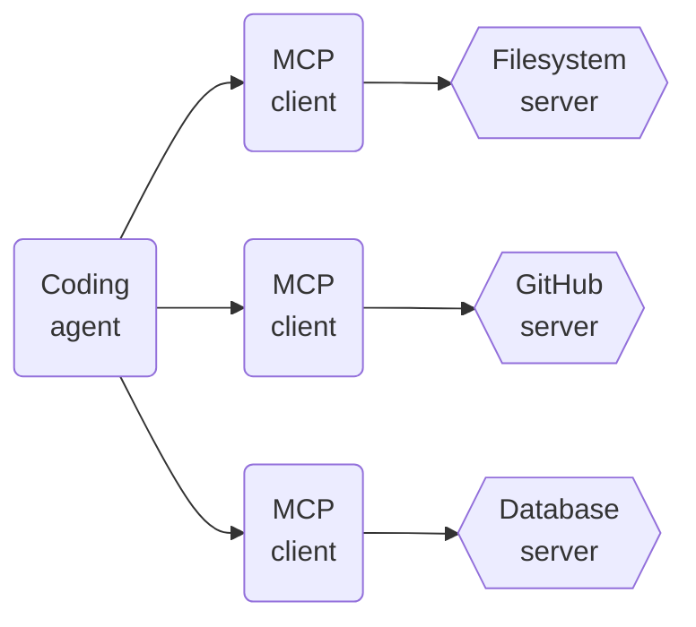

# MCP for Coding Agents

A coding agent can read your repository and run your tests. It cannot see the Jira ticket, the Sentry error, the Figma frame, or the production table — so you paste them into chat, one screenshot and stack trace at a time. That works until it doesn't: the pasted context goes stale, the formatting breaks, and the agent still cannot act on the system it is reading about.

MCP is the standard that replaces the pasting.

```callout
**In one sentence:** the Model Context Protocol is an open standard that lets a coding agent connect to external tools and data through small servers, instead of every integration being a custom, one-off build.
```

## The problem it solves

Anthropic's launch post described the situation plainly: "Every new data source requires its own custom implementation, making truly connected systems difficult to scale."

If you have M AI applications and N data sources, custom integrations trend toward M×N work. A standard turns that into M+N: each application speaks the protocol once, each source exposes a server once.

The analogy the project uses is USB-C — a standard port for connecting AI applications to external systems. The comparison is about shape, not quality: any given server still has to be trustworthy.

## Host, client, server

MCP has three participants:

- **Host** — the AI application. Claude Code, Claude Desktop, VS Code, Cursor, and others act as hosts.
- **Client** — a component inside the host that maintains a dedicated connection to one server.
- **Server** — a program that provides context or actions.

A host creates one client per server. The protocol docs use VS Code as an example: connect to Sentry, and the runtime instantiates a client for the Sentry server; connect to a local filesystem server, and it instantiates another client for that one.



Servers can run locally or remotely. The distinction is the transport, not the protocol.

## What a server exposes

MCP defines three core server primitives:

| Primitive | What it is | Example |
| --- | --- | --- |
| **Tools** | Functions the AI application can invoke | Query a database, open a pull request |
| **Resources** | Context data the application can read | File contents, a database schema |
| **Prompts** | Reusable interaction templates | A system prompt or few-shot examples |

A database server might expose all three: tools for querying, a resource containing the schema, and a prompt with examples for using the tools. The model discovers what is available (`tools/list`), then calls what it needs (`tools/call`).

This is the same tool-calling loop from the earlier [Function Calling](../tutorials/function-calling.md) tutorial. MCP standardises how the tools are discovered, described, and reached.

## Two transports

- **Stdio** — the server runs as a local process and communicates over standard input/output. Good for filesystem access, local scripts, and tools that need direct system access.
- **Streamable HTTP** — the server runs remotely and communicates over HTTP, with optional server-sent events for streaming. Good for cloud services and shared infrastructure.

Claude Code's docs note that its older SSE transport is deprecated in favour of HTTP. If a server only offers SSE, Claude Code can still connect, but new servers should use HTTP.

## Wiring one into a coding agent

Claude Code exposes MCP through a small set of commands. A remote HTTP server:

```bash
claude mcp add --transport http notion https://mcp.notion.com/mcp
```

A local stdio server, with an API key and the `--` separator between Claude's flags and the server command:

```bash
claude mcp add --env AIRTABLE_API_KEY=YOUR_KEY --transport stdio airtable \
  -- npx -y airtable-mcp-server
```

Scopes control where the configuration lives:

| Scope | Stored in | Shared with |
| --- | --- | --- |
| `local` (default) | Your local config | Only you, current project |
| `project` | `.mcp.json` | Everyone in the repo |
| `user` | Your user config | You, across projects |

Then:

```bash
claude mcp list          # health status per server
claude mcp get notion    # details for one server
claude mcp remove notion # remove it
```

Inside a session, `/mcp` shows connected servers, their tool counts, and authentication state. Project-scoped servers in `.mcp.json` require approval the first time you trust a workspace — a cloned repository cannot silently approve its own servers.

## When to add one

Claude Code's docs give the simplest trigger: connect a server when you find yourself **copying data into chat from another tool**, like an issue tracker or a monitoring dashboard.

Common cases:

- implement the feature described in a ticket, then open the PR
- read the error and the deploy that introduced it
- query the database for the users affected by a bug
- pull the design frame instead of screenshotting it

If you are not copying anything, you probably do not need a server. The built-in file and shell tools already cover the repository.

## Build or install

The ecosystem already has servers for many systems; the Anthropic Directory and the `modelcontextprotocol/servers` repository are the starting points. Installing one is usually a single command.

If nothing fits, build a small server. The protocol docs have server guides and SDKs, and Claude Code ships an `mcp-server-dev` plugin that scaffolds a local stdio or remote HTTP server from a description of your use case. Start with the narrowest server that solves the copying problem — one tool with a clear description beats a broad server with a dozen overlapping ones.

## Security is the real work

An MCP server is code with access to something you care about, invoked by a model that can be influenced by content it reads. Treat it accordingly.

Claude Code's documentation warns directly: verify that you trust each server before connecting it, because "servers that fetch external content can expose you to prompt injection risk."

Practical rules:

- **Least privilege.** Give a database server a read-only role unless writes are the point.
- **Separate credentials.** Do not hand a server your personal admin token when a scoped token will do.
- **Review project servers.** A `.mcp.json` in a repository is executable configuration; approve it only after reading it.
- **Watch the output.** Claude Code warns when MCP tool output exceeds 10,000 tokens and caps it at 25,000 by default. Large outputs are context spent, and a malicious or noisy server can flood the window.
- **Disconnect what you do not use.** Every connected server adds tool definitions to the agent's context. More servers is not free.

That last point connects back to context engineering: an MCP server is a context interface, and interfaces cost tokens. Böckeler's primer on coding-agent context notes that "the more of these you configure, the more space they take up in the context," and recommends thinking strategically about which are necessary for the task. Some agents now use progressive tool discovery or tool search so that large server catalogs do not all load up front.

## Common failure modes

| Symptom | Likely cause | Fix |
| --- | --- | --- |
| Server added but never used | Tool description is vague or overlaps another tool | Make the description say what it does and when to use it |
| `Failed to connect` | Wrong transport, URL, or missing auth | Check `claude mcp list` and the server's setup instructions |
| Server works, results are huge | Tool returns raw records or full logs | Narrow the query or add pagination/limits in the server |
| Agent reads untrusted content and acts oddly | Prompt injection through fetched text | Treat fetched content as data; restrict tools and permissions |
| Teammates cannot use it | Server was added at `local` scope | Re-add with `--scope project` and commit `.mcp.json` |
| Context fills up faster | Too many servers loaded | Disable unused servers; prefer on-demand tools |

## A checklist

- Is there a real copy-paste loop this server removes?
- Do you trust the server and its author?
- Is it using the narrowest credentials that work?
- Is the scope right — local, project, or user?
- Are the tool descriptions specific enough to choose between?
- Have you capped or paginated large outputs?
- Did you check the context cost of leaving it connected?

## Glossary

- **MCP** — Model Context Protocol, an open standard for connecting AI applications to external systems.
- **Host** — the AI application that manages connections.
- **Client** — the per-server connection inside a host.
- **Server** — a program exposing tools, resources, and prompts.
- **Tool** — a callable action exposed by a server.
- **Resource** — read-only context exposed by a server.
- **Stdio / Streamable HTTP** — local process and remote HTTP transports.
- **Prompt injection** — untrusted content steering the model's behaviour.

## Wrapping up

MCP is plumbing, and that is the point. It turns "paste the ticket into chat" into "the agent can read the ticket," and it turns every new integration into a server rather than a custom adapter. The wins are real; so is the attack surface. Connect narrowly, scope credentials, and remember that every server you leave on is paying rent in context.

That closes the AI-assisted coding track. The through-line: brief the agent, protect its context, give it a spec to work against, and connect it deliberately.

## Sources

- Anthropic, [Introducing the Model Context Protocol](https://www.anthropic.com/news/model-context-protocol), November 2024 — original problem statement, open standard, SDKs, reference servers.
- [Model Context Protocol — Introduction](https://modelcontextprotocol.io/docs/getting-started/intro) — USB-C analogy, ecosystem support, what MCP enables.
- [MCP Architecture overview](https://modelcontextprotocol.io/docs/learn/architecture) — host/client/server, primitives, transports, JSON-RPC.
- Claude Code docs, [Connect Claude Code to tools via MCP](https://code.claude.com/docs/en/mcp) — installation commands, scopes, `/mcp`, trust and prompt-injection warnings, output limits.
- Birgitta Böckeler, [Context Engineering for Coding Agents](https://martinfowler.com/articles/exploring-gen-ai/context-engineering-coding-agents.html) — MCP servers as context interfaces and their context cost.
- [modelcontextprotocol/servers](https://github.com/modelcontextprotocol/servers) — reference server implementations.
