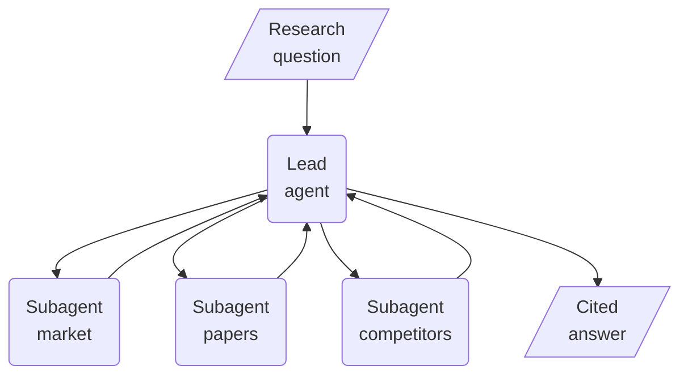

# Multi-Agent Orchestration

The demo is always the same. Three agents sit in a chat window, politely handing work to each other, and the audience applauds. Then you build it for real and discover that two agents repeated the same search, a third contradicted the plan, and the final answer quietly dropped the one finding that mattered.

Multi-agent systems are not a quality dial. They are an architecture for splitting context and work across isolated windows. Used for the right shape of problem, they are excellent. Used as "more agents, more intelligence," they are an expensive way to lose the thread.

```callout
**In one sentence:** multi-agent orchestration buys you parallel context windows and separated permissions, at the price of coordination — so use it when work is parallel and read-heavy, not when decisions depend on each other.
```

## What the split actually buys

Anthropic's engineering write-up on their research system is the most concrete public account. Their architecture is an **orchestrator-worker** pattern: a lead agent plans, spawns subagents, and synthesises their results. Each subagent gets its own context window, its own tools, and a narrow assignment.

The reported result: a system with Opus 4 as lead and Sonnet 4 subagents outperformed single-agent Opus 4 by 90.2% on their internal research evaluation. The more useful finding is why. Their analysis found that token usage by itself explained 80% of the variance in BrowseComp performance — the multi-agent system was winning largely because it could spend more tokens in parallel, not because each agent was smarter.

They are equally clear about the bill: agents typically use about 4× the tokens of a chat interaction, and multi-agent systems about 15×. That is the trade. You are buying parallel context, and context is not free.



## The counter-argument

Cognition's "Don't Build Multi-Agents" is the necessary counterweight. Their argument rests on two principles:

1. **Share context.** Subagents that do not see the same context make conflicting assumptions.
2. **Actions carry implicit decisions.** When an agent writes a file or sends a message, it has already decided things that later agents cannot see and may contradict.

From those principles they argue for a single-threaded linear agent, with context compression rather than context splitting, for tasks where the work is interdependent — especially writing code. A subagent that edits a file without seeing why another subagent changed a neighbouring file is not parallelism; it is a merge conflict with extra steps.

Both positions are right about different workloads. The disagreement is a signal about where the boundary sits.

## When to split, and when not to

| Split when | Keep it single-threaded when |
| --- | --- |
| Subtasks are independent and read-only | Steps depend on each other's decisions |
| Each subtask needs a different tool or permission | Everyone needs the same files and history |
| You want parallel search or breadth | You are writing one coherent artifact |
| One context window cannot hold the material | The task fits comfortably in one window |
| Subagents can return bounded, checkable output | Subagents would return long prose the lead must reconcile |

The last row is the one people miss. A subagent that returns three pages of findings has moved the context problem, not solved it. A subagent that returns a validated list of ten records with sources has genuinely compressed the work.

## Four patterns worth knowing

| Pattern | Shape | Good for | Main risk |
| --- | --- | --- | --- |
| **Orchestrator-worker** | Lead plans, fans out, synthesises | Research, broad search, independent checks | Lead becomes the bottleneck |
| **Pipeline** | Fixed stages, each hands off | Extraction → enrichment → formatting | Errors compound silently |
| **Supervisor with shared state** | A router picks the next specialist | Support triage, multi-tool workflows | Routing loops |
| **Critic / debate** | One produces, another reviews | Code review, factual checks | Agreement without evidence |

Pipelines and supervisors are closer to ordinary workflow engineering than to autonomous agents. That is usually a feature: a fixed graph is easier to test, trace, and bound than a conversation between peers.

## Coordination is where it breaks

The MAST study analysed 150 traces across several multi-agent systems and identified 14 failure modes in three categories: system design issues, inter-agent misalignment, and task verification. Inter-annotator agreement was high (κ = 0.88), so these are not one reviewer's opinions.

The categories are a useful diagnostic checklist:

- **System design** — the topology or role definition is wrong. A role that overlaps another role produces duplicated work; a missing role produces a gap nobody owns.
- **Inter-agent misalignment** — agents disagree, ignore each other, or fail to share the information the next step needs. This is Cognition's point, observed empirically.
- **Task verification** — nobody checks the final output against the original request, so a confident wrong answer ships.

The paper also shows the fixes can be small. In one ChatDev case, ensuring the CEO agent had the final say instead of letting another agent terminate early raised task success by 9.4%. Coordination bugs often look like governance bugs: who is allowed to end the task, and who owns the answer.

## A minimal orchestrator

The shape below is deliberately boring: a bounded fan-out, a hard cap on concurrency, and a synthesis step that receives structured results rather than raw transcripts.

```python
import asyncio

async def run_subagent(task: dict, budget: int) -> dict:
    result = await agent.run(task["prompt"], max_tokens=budget)
    return {
        "task": task["name"],
        "summary": result.summary,
        "sources": result.sources,
        "status": "ok",
    }

async def orchestrate(question: str) -> str:
    plan = await planner.create(question, max_subtasks=4)
    semaphore = asyncio.Semaphore(3)

    async def bounded(task):
        async with semaphore:
            return await run_subagent(task, budget=8_000)

    results = await asyncio.gather(*(bounded(t) for t in plan.tasks))
    ok = [r for r in results if r["status"] == "ok"]

    return await synthesiser.write(question=question, findings=ok)
```

Three details do most of the work. `max_subtasks` bounds the fan-out before it starts. The semaphore bounds concurrency so you do not melt a rate limit. And the synthesiser gets summaries with sources, not the subagents' full message histories.

## Budgets and stopping conditions

Multi-agent systems fail expensively. Set the limits before the first run:

- **Max subagents** per request, and max retries per subagent.
- **Max tokens** per subagent, separate from the lead's budget.
- **Wall-clock deadline** for the whole job, with a partial-result path.
- **A definition of done** the lead can check, not just "when it feels finished."

If the lead can spawn subagents recursively, cap depth explicitly. Unbounded recursion is the multi-agent equivalent of an infinite loop, except it bills per token.

## Observability is not optional

A single agent's transcript is one thing to read. A multi-agent run is a tree of interleaved calls, and without traces you cannot tell whether a bad answer came from a bad plan, a bad subagent, or a bad synthesis. Capture the plan, each subagent's assignment and output, the token count per branch, and the final synthesis input. The [LLM observability](../tutorials/llm-observability.md) tutorial covers the span structure; the important part here is that each subagent is its own span with its own cost.

## Common failure modes

| Symptom | Likely cause | Fix |
| --- | --- | --- |
| Duplicated work across subagents | Overlapping role definitions | Assign non-overlapping scopes in the plan |
| Final answer ignores a finding | Synthesis only saw summaries, or lost one | Require structured findings with IDs and check coverage |
| Cost explodes on simple questions | Lead always fans out | Add a complexity gate; single agent for easy tasks |
| Subagents contradict each other | No shared context or no reconciliation step | Pass shared constraints; make the lead resolve conflicts explicitly |
| Run never ends | Recursive spawning or no done condition | Cap depth, retries, and wall-clock time |
| Confident wrong answer | No verification stage | Add a checker that compares output to the original request |

## A checklist

- Can one agent with a bigger context do this? If yes, do that first.
- Is the work genuinely parallel, or just split?
- Does every subagent have a non-overlapping, testable assignment?
- What exactly does a subagent return — prose, or bounded structured data?
- Who owns the final answer, and who is allowed to stop the run?
- Are max subagents, tokens, retries, and wall-clock time all capped?
- Can you reconstruct the whole tree from traces after a bad run?
- Have you measured the multi-agent version against a single-agent baseline on your own evals?

## Worked example

A research lead handles "Compare Q3 pricing for Acme and Globex and flag EU regulatory changes" under a four-subagent cap and a three-slot concurrency limit.

**Input:** `max_subtasks=4`, `Semaphore(3)`, `budget=8_000` tokens per subagent; the question covers Acme, Globex, and EU rules.
**Output:** plan has three tasks — `pricing-acme`, `pricing-globex`, `regulations-eu`; the first synthesis gets two `ok` findings with sources, and a coverage check flags the missing EU item for one retry.

- `len(plan.tasks) == 3 <= 4` → fan out all three; no task is dropped.
- Three tasks, three semaphore slots → all start in one wave; a fourth task would wait.
- `pricing-acme` uses 6,140 tokens < 8,000 → status `ok`, two sources returned.
- `pricing-globex` uses 7,320 tokens < 8,000 → status `ok`, one source returned.
- `regulations-eu` hits 8,000 tokens → status `truncated`, excluded from `findings`; the verifier sees the "EU" constraint uncovered and asks for one retry.

The verification bullet is the one a demo usually omits: bounded outputs make it possible to check coverage instead of trusting the synthesis.

## Glossary

- **Orchestrator** — the agent or controller that plans and delegates.
- **Subagent** — an isolated agent invocation with its own context and tools.
- **Handoff** — passing control and context from one agent to another.
- **Fan-out / fan-in** — dispatching parallel work, then collecting results.
- **Context isolation** — giving each agent a separate window, so one agent's noise does not pollute another's.
- **MAST** — a taxonomy of multi-agent failure modes from the 2025 study.
- **Synthesis** — combining subagent results into the final answer.

## Wrapping up

Multi-agent orchestration is a context architecture, not a capability upgrade. Split when the work is parallel, read-heavy, and separable; keep it linear when decisions compound. Cap the fan-out, demand bounded outputs, give one agent the final say, and measure against a single-agent baseline before you pay 15× for the privilege.

## Sources

- Anthropic, [How we built our multi-agent research system](https://www.anthropic.com/engineering/multi-agent-research-system), June 2025 — orchestrator-worker design, 90.2% internal eval result, token usage and the 15× cost figure.
- Walden Yan (Cognition), [Don't Build Multi-Agents](https://cognition.ai/blog/dont-build-multi-agents), June 2025 — share context, actions carry implicit decisions, the case for single-threaded agents.
- Cemri et al., [Why Do Multi-Agent LLM Systems Fail?](https://arxiv.org/abs/2503.13657), 2025 — MAST taxonomy: 14 failure modes, three categories, 150 traces.
- LangGraph, [Multi-agent systems](https://docs.langchain.com/oss/python/langgraph/multi-agent) — supervisor, handoff, and network patterns.
