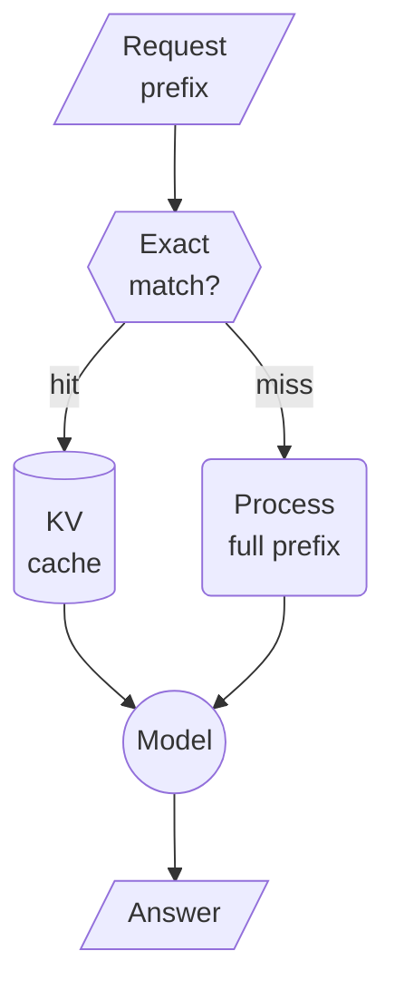

# Prompt Caching and Token Economics

An agent sends the same 8,000-token instruction block, tool definitions, and policy document on every turn. A thirty-turn session pays for that prefix thirty times, even though nothing about it changed after the first request. The model is not learning your prompt. It is recomputing it.

Prompt caching fixes that by reusing the intermediate states for the unchanged prefix. It is one of the few optimisation techniques where the mechanism is simple, the savings are large, and almost every failure is a placement mistake.

```callout
**In one sentence:** caching reuses key/value states for an exact, unchanged prompt prefix — put stable content first, keep changing content after the breakpoint, and verify the hit rate in usage fields.
```

## What is actually cached

When a model processes input tokens, it computes intermediate key/value (KV) states that let later tokens attend to earlier ones. Prompt caching stores those KV states, not the text, and not the answer.



Three consequences follow directly:

- **It is a prefix, not a bag of tokens.** Reordering the prompt or inserting a token near the front invalidates everything after that point.
- **It is exact.** A timestamp, a different tool schema, or an extra space in a system message means a miss. Embedding similarity is not involved.
- **It does not speed up generation.** Output tokens are still produced one at a time. Caching shortens the wait before the first token.

OpenAI's guide describes the cache as preserving KV states for an eligible prefix; Anthropic's docs describe a hierarchy covering `tools`, `system`, then `messages`. Different providers, same underlying idea.

## The arithmetic

Pricing changes, so work with multipliers from your provider's current pricing page. The common shape is:

| Token class | Typical multiplier of base input price |
| --- | --- |
| Ordinary input | 1× |
| Cache read | about 0.1× (some models lower) |
| Short-lived cache write | about 1.25× |
| Long-lived cache write | about 2× or more |

A cache write costs *more* than ordinary input the first time. The saving comes from every read after it.

Take a prefix of 8,000 tokens, a per-request question of 200 tokens, and 30 requests. Assume a base input price of $1 per million tokens, a 0.1× read rate, and a 1.25× write rate. Ignore output tokens.

```text
Uncached:
  30 × (8,000 + 200)                = 246,000 weighted tokens

Cached:
  first write: 8,000 × 1.25         =  10,000
  29 reads:    29 × 8,000 × 0.1     =  23,200
  questions:   30 × 200             =   6,000
                                      --------
                                      39,200 weighted tokens
```

That is roughly an 84% reduction in input cost for this example. At two requests, the same prefix would cost *more* with caching than without it. Reuse is the whole business case.

The formula generalises: for a prefix of `P` tokens, `N` requests, write multiplier `w`, and read multiplier `r`, cached input cost is `P × (w + (N−1) × r)` versus `N × P` uncached. Plug in your own numbers before celebrating.

## Breakpoint placement is the job

A breakpoint marks the end of the prefix you want to reuse. The first request writes up to that point; later requests read it. The rule is blunt: **place the breakpoint on the last block that is identical across the requests that should share the cache.**

The classic mistake looks reasonable:

```text
system: "You are a helpful assistant. Today is 2026-11-23."
user:   "Summarise this document..."
```

Put a breakpoint after the user message and the cached hash includes today's date. Tomorrow every request misses. Put it after the system text and the timestamp still breaks it. The fix is to move varying content out of the prefix entirely:

```text
system: "You are a helpful assistant."
user:   "Current date: 2026-11-23. Summarise this document..."
        ^ breakpoint after the stable system block
```

Anthropic's documentation spells out the trap in detail: writes occur only at the breakpoint, and the backward lookup finds entries that earlier requests wrote — it does not discover stable content behind a badly placed breakpoint. OpenAI's guides make the same point from the other direction: changing `tools`, tool ordering, the model, or a response-format setting can change the rendered prefix even when the visible prompt text looks identical.

## What invalidates a cache

| Change | Typical impact |
| --- | --- |
| Different model | New cache namespace; plan on a miss |
| Tool definition, description, schema, or ordering changes | Often invalidates tools, system, and messages |
| Editing the system prompt | Invalidates system and everything after it |
| Adding or removing an image | Invalidates message-level cache |
| Changing reasoning effort or verbosity settings | Can change hidden or rendered instructions |
| Timestamp or request ID inside the cached prefix | Guaranteed miss on every request |
| Compaction or rewriting earlier conversation turns | Resets reuse from the first changed token |
| Adding a new message at the end | Usually fine: the prefix is unchanged |

Two useful habits follow:

1. **Keep tool definitions append-only.** If a request should not use a tool, disable it with the API's tool-choice mechanism rather than removing its definition.
2. **Append, never rewrite.** Multi-turn conversations are the best caching workload precisely because each new turn leaves the old prefix intact.

If you need several freshness domains, use more than one breakpoint. Stable instructions can have a long-lived cache entry; session context can have a short-lived one. Both OpenAI and Anthropic support multiple breakpoints, with provider-specific limits.

## Provider differences worth knowing

The mechanism is shared; the controls are not. Check the current docs before you copy an example.

- **OpenAI** — caching is enabled by default on supported models. Newer models support explicit breakpoints via `prompt_cache_options.mode` and `prompt_cache_breakpoint`, with 30-minute or 12-hour lifetimes. Older models use implicit breakpoints and a `prompt_cache_key` that helps route related requests to the same machine. There is a minimum cacheable prefix length, around 1,024 tokens on newer models.
- **Anthropic** — `cache_control` can be set once at the top level for automatic caching in conversations, or on individual content blocks for explicit control. The default TTL is 5 minutes; a 1-hour TTL costs more. There is a 20-block lookback window for finding earlier writes, and minimum prefix lengths vary by model.
- **Gemini** — implicit caching is on by default for Gemini 2.5 and newer models, with no configuration required; minimum token thresholds vary by model. Explicit cache objects are available on supported models through the `generateContent` API, not the Interactions API.

Do not design around one provider's dollar figures. Design around prefix stability, then read the pricing page when you calculate savings.

## Measure the hit rate

Every provider reports cache usage in the response. Track these fields as metrics, not curiosities:

| Provider | Useful usage fields |
| --- | --- |
| OpenAI | `cached_tokens`, `cache_write_tokens`, lifetime breakdowns |
| Anthropic | `cache_read_input_tokens`, `cache_creation_input_tokens`, `input_tokens` |
| Gemini | `total_cached_tokens` |

Define a token cache-hit rate:

```text
cache hit rate = cached tokens / total input tokens
```

Then watch it by feature, model, and prompt version. A sudden drop usually means someone changed a tool schema, injected a timestamp into the system prompt, or upgraded the model. Alert on it the way you would alert on an error rate.

Also track realised cost per request. A high hit rate on a tiny prefix is less valuable than a modest hit rate on a large one, and cache writes can make a low-traffic feature more expensive than no caching at all.

## Stack it with the other cost levers

Caching is one tool in a set:

- **Batch APIs** trade latency for a discount on asynchronous work. They compose with caching where the provider allows it.
- **Model routing** sends easy turns to a cheaper model and escalates hard ones. See [Reasoning Models](../tutorials/reasoning-models.md) for the effort/cost trade-off.
- **Shorter prefixes** beat clever caching. Do not carry six variants of the same instruction "just in case".
- **Prompt versioning** makes cost regressions attributable. A prefix change without a version tag is a mystery.
- **Serving discipline** — timeouts, retries, and streaming — is covered in [Serving LLM Applications in Production](../tutorials/serving-llm-apps.md). Retries after a cache expiry can quietly rewrite prefixes.

There is a minimum-length trap: a prefix just below the cacheable threshold cannot be cached at all. Padding it with useful, stable examples can pay off at high request volume, but only do the arithmetic. OpenAI's guide gives the break-even formula; with typical multipliers and 1,024-token minimum, a 1,024-token prefix beats an uncached 221-token one across ten requests. At low volume, keep the shorter prompt.

## Common failure modes

| Symptom | Likely cause | Fix |
| --- | --- | --- |
| Cache hit rate near zero | Breakpoint after varying content | Move the breakpoint to the last stable block |
| Cost rose after enabling caching | Too few requests to amortise writes | Remove caching for low-volume paths |
| Hits work locally, not in production | Model, tool schema, or prompt version differs | Compare the full rendered request, not just visible text |
| Hits disappear mid-session | TTL expired or conversation was rewritten | Extend TTL or make history append-only |
| Multi-turn hits stop after long threads | Breakpoint drifted beyond the provider's lookback | Add another breakpoint further back |
| Two tenants share unexpected cache state | No cache key separation | Use per-tenant keys where the provider supports them |
| Latency barely improved | Generation dominates, not input processing | Look at model choice and output length instead |
| Billing does not match the dashboard | Cache writes counted as ordinary input | Sum read, write, and ordinary tokens separately |

## A checklist

- Is the stable content first, with changing content after the breakpoint?
- Are timestamps, request IDs, and per-user values out of the cached prefix?
- Are tool definitions and their ordering stable across requests?
- Is the conversation history append-only?
- Is there a breakpoint per freshness domain where needed?
- Have you checked the current minimum prefix length and TTL options for your model?
- Are cache reads, writes, and ordinary tokens tracked separately in cost reports?
- Is there an alert on cache hit rate by prompt version?
- Have you recalculated savings after the last pricing or model change?

## Check yourself

```quiz
{
  "questions": [
    {
      "q": "A system prompt embeds the current timestamp, and the cache breakpoint sits after the user message. What happens on the next request?",
      "options": ["A cache hit, because the user message is the same", "A cache miss, because the timestamp changed the prefix hash", "A cache hit with higher write cost", "Nothing; timestamps are excluded from caching"],
      "answer": 1,
      "why": "Cache matching is exact. The timestamp changes the prefix, so the stored KV state no longer matches."
    },
    {
      "q": "Why can prompt caching increase cost for a low-volume feature?",
      "options": ["Cache reads cost more than ordinary input", "Cache writes cost more than ordinary input and may never be reused", "It requires a larger model", "It disables batch pricing"],
      "answer": 1,
      "why": "A cache write is typically 1.25× or more of the base input rate; savings only appear when later requests read that entry."
    }
  ]
}
```

## Worked example

A support triage agent handles 12 turns on ticket #4821; the system prompt, tool schemas, and refund policy form a 5,200-token prefix, and each turn adds 180 tokens.

**Input:** 12 requests, 5,200-token prefix, 180 tokens per turn, $2 per million input tokens, 0.1× cache read, 1.25× cache write.
**Output:** broken prefix (ticket ID inside) costs 80,160 weighted tokens ($0.160); fixed prefix costs 14,380 ($0.029), versus $0.129 uncached.

```text
broken: "Ticket #4821" in system block → 12 writes, no reads
  12 × 5,200 × 1.25 + 12 × 180 = 80,160 tokens → $0.160

fixed: ticket ID moved into the user turn → 1 write + 11 reads
  5,200 × 1.25      =  6,500
  11 × 5,200 × 0.1  =  5,720
  12 × 180          =  2,160
  total             = 14,380 tokens → $0.029
```

Moving the varying field after the breakpoint saves 78% against uncached input; leaving it inside costs 24% more than no caching at all.

## Glossary

- **KV cache** — stored key/value attention states for a processed prefix.
- **Prefix** — the unchanged tokens at the start of a prompt.
- **Breakpoint** — the marker that ends a cacheable prefix.
- **Cache read** — reusing an existing KV entry, billed at a discount.
- **Cache write** — creating a KV entry, billed above the ordinary input rate.
- **TTL** — how long a cache entry remains available.
- **Cache hit rate** — cached tokens divided by total input tokens.
- **Compaction** — rewriting earlier conversation into a summary, which usually changes the prefix.

## Wrapping up

Prompt caching rewards boring, disciplined prompts. Keep the reusable material first, keep everything that changes after the breakpoint, and never let a timestamp sneak into the prefix. Measure hit rate and realised cost together: the first is a diagnostic, the second is the point.

## Sources

- OpenAI, [Prompt caching](https://platform.openai.com/docs/guides/prompt-caching) — prefix mechanics, implicit and explicit breakpoints, TTLs, usage fields, and break-even arithmetic.
- Anthropic, [Prompt caching](https://docs.anthropic.com/en/docs/build-with-claude/prompt-caching) — `cache_control`, automatic caching, cache invalidation, lookback window, and pricing multipliers.
- Google, [Context caching](https://ai.google.dev/gemini-api/docs/caching) — implicit caching defaults, minimum token thresholds, and explicit caching availability.
