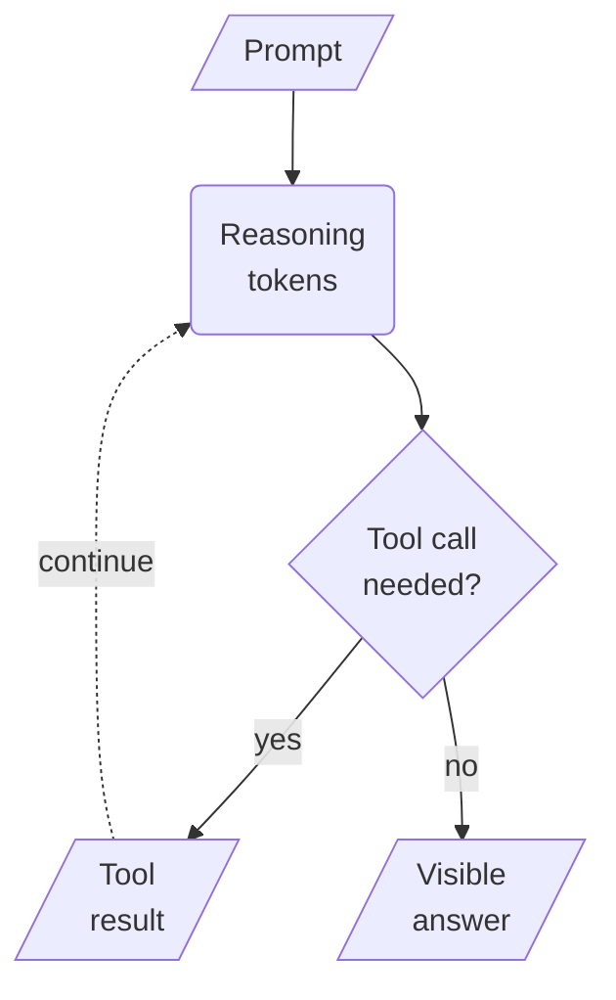

# Reasoning Models

You swap the model name, ship, and watch latency triple. The output is better on the hard cases and no better on the easy ones. The bill is larger than the token counts in your logs suggest, because a chunk of what you paid for never appears in the response.

That chunk is the reasoning. Reasoning models spend tokens thinking before they answer, and understanding that budget is the difference between using them well and using them expensively.

```callout
**In one sentence:** reasoning models trade latency and hidden output tokens for better planning on hard tasks — so raise effort deliberately, budget for tokens you cannot see, and stop prompting them like a chat model.
```

## What actually changed

A conventional chat model maps input tokens to output tokens. A reasoning model produces an internal sequence of reasoning tokens first, then the visible answer. Those tokens are used to plan, inspect alternatives, recover from ambiguity, and decide when to call a tool.

Two properties follow, and both matter operationally:

- **The reasoning is not visible through the API.** You get the answer, and optionally a summary. You do not get the raw trace.
- **The reasoning is still billed and still occupies context.** It is charged as output tokens and counts against the context window, even though you never see it.

That is the whole mental model. Everything else is a consequence.



The dashed edge is where multi-step agents live. A reasoning model can think between tool calls, which is exactly what makes it good at agentic work — and exactly why preserving its reasoning state across calls matters.

## The hidden token budget

The usage object separates the two kinds of output:

```json
{
  "usage": {
    "input_tokens": 812,
    "output_tokens": 1186,
    "output_tokens_details": {
      "reasoning_tokens": 1024
    }
  }
}
```

Here, most of the output was thinking. A dashboard that charts `output_tokens` without this breakdown will show a cost spike with no visible cause.

The practical consequences:

- **`max_output_tokens` includes reasoning.** Set it too low and the model can exhaust the budget before writing a single visible token.
- **You can pay for nothing.** If the response ends with `status: "incomplete"` and reason `max_output_tokens`, you may have bought input plus reasoning and received no answer.
- **Context shrinks.** Reasoning tokens occupy space in the window, so a long agent run needs more headroom than the message history suggests.

OpenAI's guidance for early experimentation is to reserve at least 25,000 tokens for reasoning and outputs, then tune down once you know the task's typical consumption. That is a starting buffer, not a universal constant.

## Effort is a dial, not a switch

Most providers expose a reasoning effort setting. The exact values are model-dependent — a common ladder is `none`, `minimal`, `low`, `medium`, `high`, `xhigh`, with some models supporting only a subset — but the shape is consistent: lower effort favours latency and cost, higher effort lets the model think longer.

| Task | Starting effort | Why |
| --- | --- | --- |
| Classification, routing, extraction | `none` or `low` | The answer is in the input |
| Support replies, simple tool use | `low` | Some planning, tight latency |
| Agentic coding, research, analysis | `medium` | The default balance |
| Complex debugging, long-horizon work | `high` | Quality matters more than time |
| Deep research, security review | `xhigh` only if evals justify it | Diminishing returns are real |

Two rules keep this honest. Start one level lower than you think you need, and move up only when your evaluation shows a gain. "Max effort everywhere" is how teams end up with a slow product and a bill they cannot explain.

Some APIs also support changing effort mid-conversation, so a cheap first pass can be followed by a deeper second pass without rebuilding the request. Use it when the task has an obvious escalation point, not as a substitute for choosing a default.

## Prompting a reasoning model

The prompting style that works for chat models actively hurts here. You do not need to narrate the steps; the model already plans. You need to define the problem precisely.

- **State the goal, constraints, and definition of done.** "Refactor the auth module so tests pass without changing the public API" beats "think step by step about the auth module."
- **Do not script the reasoning.** Long chain-of-thought instructions duplicate work the model is already doing and can constrain it to a worse path.
- **Provide tools, not procedures.** Let it decide when to search, read, or run tests.
- **Give it the success check.** Tests, a schema, a rubric — anything it can use to verify itself.
- **Ask for a preamble if latency is visible.** A short "here's what I'm checking" before deep work makes the wait feel shorter, and some APIs support a dedicated commentary phase.

If you need an explanation for users, request a reasoning summary rather than trying to extract the raw trace. Summaries are opt-in and their availability varies by model.

## Multi-turn and tool calls

This is where reasoning models differ most from chat models, and where silent quality loss happens.

Within a tool loop, the model's reasoning items are part of the state. If you pass back only the assistant's visible text and the tool result, you strip the context it built before the call. The next step starts colder than it should.

The APIs offer two ways to keep it:

- **Server-side state.** Reference the previous response by ID and let the provider carry the items forward.
- **Client-side replay.** Keep the full output array — including reasoning items — in order, append the tool result, and send it all back. In stateless mode, reasoning items can carry encrypted content you replay without being able to read it.

Two caveats:

1. **Reasoning reuse is model-family scoped.** Switching families drops incompatible items, even if you asked to keep everything.
2. **Changing the history prefix can invalidate reasoning.** Keep instructions and earlier tool outputs stable where you can; prompt caching and reasoning continuity both depend on it.

If you are building an agent loop, treat reasoning items as part of the transcript. Dropping them is the reasoning-model equivalent of deleting half the conversation.

## When not to use one

Reasoning models are not a default upgrade. Skip them when:

- **The task is lookup-shaped.** Classification, extraction, routing, and short rewrites rarely benefit.
- **Latency is the product.** Voice, autocomplete, and interactive search need fast first tokens.
- **The output is tightly constrained.** Heavy schema constraints plus heavy reasoning can fight each other; measure both.
- **You have not evaluated the cheaper model.** Often the smaller model with a better prompt wins on cost and ties on quality.

The right question is not "which model is smartest" but "which is the cheapest model that passes my evals on this task."

## A request with a budget

```python
response = client.responses.create(
    model="your-reasoning-model",
    reasoning={"effort": "medium"},
    max_output_tokens=8_000,
    input=[
        {"role": "system", "content": "You are a careful code reviewer. Cite file and line."},
        {"role": "user", "content": diff},
    ],
)

if response.status == "incomplete":
    reason = response.incomplete_details.reason
    raise RuntimeError(f"incomplete response: {reason}")

usage = response.usage
print(usage.output_tokens_details.reasoning_tokens, "tokens spent thinking")
```

Log the reasoning-token count on every call. It is the cheapest observability you can add, and it turns "why is this slow" into a number you can trend.

## Common failure modes

| Symptom | Likely cause | Fix |
| --- | --- | --- |
| Empty answer, high cost | `max_output_tokens` consumed by reasoning | Raise the limit; handle `incomplete` |
| Latency far above estimate | Effort set too high for the task | Drop a level and re-run evals |
| Agent forgets what it learned between tool calls | Reasoning items not replayed | Use `previous_response_id` or replay full output |
| Quality drops after a model switch | Reasoning is family-scoped | Rebuild the loop for the new family; re-evaluate |
| Model ignores step-by-step instructions | Prompting style is for chat models | State goals and constraints instead |
| Cost per request doubled overnight | A prompt change invalidated caching | Keep the prefix stable; check cache hits |
| Summaries missing | Not requested, or unsupported | Opt in to summaries; check model support |

## A checklist

- Is this task hard enough to need reasoning at all?
- What effort level did your evals actually justify?
- Is `max_output_tokens` large enough for reasoning plus answer?
- Do you handle `incomplete` as a distinct outcome?
- Are reasoning tokens logged and charted separately?
- Does your agent loop replay reasoning items across tool calls?
- Is the prompt prefix stable enough for caching?
- Have you compared quality and cost against the non-reasoning baseline?

## Worked example

A team is choosing an effort level for a 200-case bug-fix triage eval; high effort looked great in a demo, so the eval has to decide.

**Input:** 200 labeled diffs; `max_output_tokens=6_000`; ship gate ≥90% correct and <3 s median latency.
**Output:** `low` 88% → rejected; `medium` 94% at 1,180 reasoning tokens → shipped; `high` 95% at 3,260 tokens → rejected on cost.

- condition: `low` accuracy 176/200 = 88% < 90% gate → reject
- condition: `medium` 188/200 = 94%, 1,180 reasoning tokens, 2.7 s → passes both gates
- condition: `high` 190/200 = 95%, 3,260 reasoning tokens, 6.4 s → +2 cases for 2.8× tokens
- condition: high must beat medium by ≥5 cases to justify latency → false → reject
- outcome: ship `medium`; log `output_tokens_details.reasoning_tokens` on every request

The extra thinking at `high` was real spend for two extra correct cases out of 200 — start one level below where you think you need to be and let the eval move you.

## Glossary

- **Reasoning tokens** — internal tokens generated before the visible answer; billed as output.
- **Effort** — a setting controlling how much the model reasons; values are model-dependent.
- **Reasoning summary** — an optional, readable summary of the model's thinking.
- **Reasoning item** — the opaque state carried across turns and tool calls.
- **Incomplete response** — generation stopped early, often at the output-token limit.
- **Adaptive reasoning** — the model spending fewer tokens on easy inputs and more on hard ones.

## Wrapping up

Reasoning models are a budget decision as much as a capability decision. The thinking is real, billed, and invisible; the effort dial is the main control; and the state has to survive your tool loop. Use them where planning is the bottleneck, measure the cost per solved task, and keep a cheaper model as the baseline you have to beat.

## Sources

- OpenAI, [Reasoning models](https://platform.openai.com/docs/guides/reasoning) — reasoning tokens, effort levels, token budgets, incomplete responses, preserving reasoning across calls, summaries.
- OpenAI, [Reasoning best practices](https://platform.openai.com/docs/guides/reasoning-best-practices) — prompting guidance for reasoning models.
- Tam et al., [Let Me Speak Freely?](https://arxiv.org/abs/2408.02442), 2024 — why heavy output constraints and reasoning can conflict.
