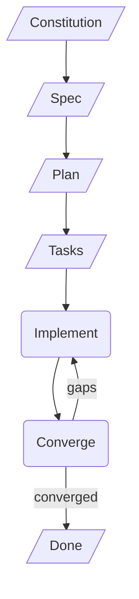

# Spec-Driven Development with Spec Kit

The most common failure in AI-assisted coding is not bad code. It is code that solves the wrong problem, confidently. You describe a feature, the agent produces something plausible, and only after review do you discover it guessed at a dozen requirements you never stated.

Spec-driven development (SDD) is the response: write the intent down first, make it the reference artifact, and let the agent work from it.

```callout
**In one sentence:** SDD turns the specification into the source of truth — specify what and why, plan how, break it into testable tasks, implement, then converge the code back against the spec.
```

## Why prompt-first fails

GitHub's introduction to Spec Kit names the pattern precisely: "you describe your goal, get a block of code back, and often… it looks right, but doesn't quite work."

Their diagnosis is not that the model cannot code. It is that "we treat coding agents like search engines when we should be treating them more like literal-minded pair programmers." A vague prompt like "add photo sharing to my app" forces the model to guess at thousands of unstated requirements. Some guesses will be wrong, and you often discover which ones deep into implementation.

A spec is a contract for how the code should behave. It gives the agent something to check against that is not its own output.

## The flow

Spec Kit's current workflow is a set of agent commands, run in chat rather than the terminal, one at a time, with a review after each:

| Step | Command | What it produces |
| --- | --- | --- |
| Constitution | `/speckit-constitution` | Project principles: code quality, testing, maintainability |
| Specify | `/speckit-specify` | What and why — user journeys, experiences, success |
| Plan | `/speckit-plan` | Stack, architecture, constraints |
| Tasks | `/speckit-tasks` | Small, reviewable, independently testable work |
| Implement | `/speckit-implement` | Code, task by task |
| Converge | `/speckit-converge` | A comparison of code against spec |

The constitution is created once per project. The remaining steps repeat for each feature. If convergence finds gaps, you implement and converge again until it reports `Converged`.



The original GitHub announcement described four phases — **Specify, Plan, Tasks, Implement** — with the same rule: "you don't move to the next one until the current task is fully validated." The constitution and convergence steps are later additions that make the process repeatable across a project rather than a single feature.

## What each artifact is for

### Specify: the what and why

The spec is not a technical design. GitHub is explicit that this phase is "not about technical stacks or app design. It's about user journeys, experiences, and what success looks like."

Questions worth answering:

- Who uses this, and what problem does it solve for them?
- What are the main flows?
- What outcomes matter?
- What is explicitly out of scope?
- How will we know it works?

A useful spec reads like acceptance criteria, not marketing copy. "A user can open a new chat, type a query, press enter, and see an AI response" is testable. "A great chat experience" is not.

### Plan: the how

Now you get technical. The plan carries the stack, architecture, constraints, and integration points. If the organisation standardises on certain technologies, this is where that goes. If there are compliance or performance requirements, they go here too.

GitHub suggests making internal architecture docs available to the agent so the plan follows existing patterns. The point is to keep the new code native to the project instead of bolted on.

### Tasks: small enough to verify

The agent breaks the spec and plan into work. The test of a good task is isolation: it can be implemented and tested on its own.

GitHub's contrast is useful:

- Bad: "build authentication."
- Better: "create a user registration endpoint that validates email format."

Each task is a checkpoint. It gives the agent a way to validate its work and gives you something reviewable that is smaller than a thousand-line dump.

### Implement: review focused changes

The agent works through the tasks. Because the spec says what to build, the plan says how, and the task says what is next, the changes arrive scoped. Your job is not just to steer but to verify.

### Converge: compare code to intent

Convergence is the step that makes the loop honest. It checks whether the implementation actually satisfies the spec, rather than whether the agent believes it does. Gaps go back into implementation; a clean report ends the feature.

## A worked example

The Spec Kit README uses a photo organiser. Trimmed to the shape of the process:

```text
/speckit-constitution Create principles focused on code quality, testing, and maintainability.
/speckit-specify Build a photo organizer with albums grouped by date and a tile preview of each album.
/speckit-plan Use Vite with vanilla JavaScript. Keep images local and store metadata in SQLite.
/speckit-tasks
/speckit-implement
/speckit-converge
```

What you review, in order:

1. **The spec** — does it capture albums, date grouping, previews, and the cases you care about? Add the missing edge cases now; it is cheap.
2. **The plan** — is the stack right? Are images really local? Is SQLite the storage you want? Correct it before tasks are generated.
3. **The tasks** — are they small enough to test? Does each one have a clear definition of done?
4. **The implementation** — review the diffs task by task.
5. **The convergence report** — are the remaining gaps real, or is the spec stale?

The leverage is in the first three reviews. A bad line of spec becomes many bad lines of code.

## Why it works

GitHub's explanation is about how language models operate: they are exceptional at pattern completion, not mind reading. A clear spec reduces the number of guesses; a plan constrains the solution space; tasks create verification points.

The deeper claim is a shift in what counts as the source of truth. GitHub puts it as moving "from 'code is the source of truth' to 'intent is the source of truth.'" That sounds grand, but the practical version is modest: when the code and the spec disagree, you now have a document to argue with.

## Where it fits best

GitHub names three scenarios:

- **Greenfield** — prevents the agent from building a generic version of your idea.
- **Feature work in existing systems** — the highest-value case, because the spec forces clarity on how the feature interacts with what already exists.
- **Legacy modernisation** — capture the business logic in a new spec, design a fresh architecture, rebuild without inherited debt.

The common thread is ambiguity. If the work is genuinely one line, or a throwaway spike, the ceremony costs more than it saves.

## Costs and limits

SDD is not free.

- **It is slower up front.** You write and review artifacts before code exists.
- **It can become documentation theatre.** A spec nobody updates is worse than no spec, because it looks authoritative while being wrong.
- **It does not remove judgment.** The agent generates the artifacts; you still have to verify them. GitHub says this directly: "The AI generates the artifacts; you ensure they're right."
- **Markdown sprawl is real.** GitHub's own announcement asks how to manage lots of spec and task files at scale.
- **Small changes do not need it.** Use the smallest process that fits.

The current toolkit acknowledges this by offering separate entry points: SDD for features, a bug-fixing extension for diagnosing broken behaviour, and an idea-assessment extension for deciding whether something is worth building at all. They are independent processes, not mandatory phases.

## Common failure modes

| Symptom | Likely cause | Fix |
| --- | --- | --- |
| Code works but misses the point | Spec described the solution, not the user outcome | Rewrite the spec around journeys and acceptance criteria |
| Plan ignores project conventions | No architecture context in the plan | Point the agent at internal docs; state constraints explicitly |
| Tasks are still huge | Spec and plan were vague | Split until each task is independently testable |
| "Done" but not actually done | No convergence check | Run the spec against the implementation, item by item |
| Spec drifts from reality | It was written once and never revised | Treat it as a living artifact; update it with each feature |

## A checklist

- Does the spec state the user, the problem, and the success condition?
- Are the acceptance criteria testable?
- Is out-of-scope written down?
- Does the plan name the stack, constraints, and integration points?
- Is every task small enough to verify in isolation?
- Did you review the spec and plan before implementation started?
- Did convergence compare code to spec, not code to vibes?

## Worked example

A team is adding CSV export to `/admin/reports` for support agents, and the first implementation passes its own tests while missing the stated behaviour.

**Input:** The acceptance criterion "export only the visible date range, in UTC, as `orders-2026-11-23.csv`" written in `specs/report-export/spec.md`.
**Output:** `/speckit-converge` first reports a gap — 2,418 rows exported instead of the 37 filtered rows — then `Converged` after one added task fixes the handler.

```text
spec.md     Export only the visible date range; UTC timestamps; filename orders-2026-11-23.csv.
tasks.md    T3: add /admin/reports/export; assert 37 rows and the content-disposition header.
converge 1  GAP: handler exported 2,418 rows; spec says 37.
converge 2  Converged: 37 rows, UTC timestamps, orders-2026-11-23.csv.
```

The gap is cheap to find because the spec named a number. Vague criteria would have let the 2,418-row export ship as "done."

## Glossary

- **Spec-driven development (SDD)** — a process where a specification drives planning, implementation, and verification.
- **Constitution** — project-level principles that constrain every feature.
- **Spec** — the behavioural contract: what and why.
- **Plan** — the technical approach: how.
- **Task** — a small, independently testable unit of implementation.
- **Convergence** — checking the implementation against the spec and closing gaps.

## Wrapping up

SDD is not a prompt template. It is a way of making intent durable enough that an agent can work against it and you can verify the result. The artifacts are cheap to edit and expensive to get wrong, which is exactly why review belongs at the start rather than after the code lands.

Next: [MCP for Coding Agents](../tutorials/mcp-coding-agents.md) — giving the agent access to the systems where the work actually lives.

## Sources

- GitHub, [Spec Kit](https://github.com/github/spec-kit) — current process, commands, constitution, convergence, extensions.
- Den Delimarsky, [Spec-driven development with AI: Get started with a new open source toolkit](https://github.blog/ai-and-ml/generative-ai/spec-driven-development-with-ai-get-started-with-a-new-open-source-toolkit/), GitHub Blog, September 2025 — four phases, rationale, use cases, limits.
- Microsoft Learn, [Spec-driven development with GitHub Spec Kit](https://learn.microsoft.com/en-us/training/modules/spec-driven-development-github-spec-kit-enterprise-developers/) — enterprise-oriented walkthrough.
- [Spec Kit SDD walkthrough](https://github.github.io/spec-kit/quickstart.html) and [command reference](https://github.github.io/spec-kit/reference/agentic-sdd.html) — detailed usage.
