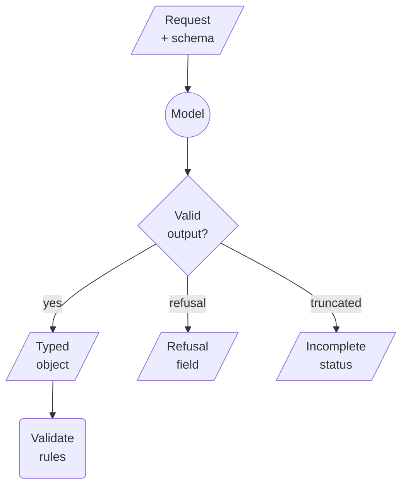

# Structured Outputs

The first version of every LLM feature ends the same way: a regex trying to find the JSON object inside a reply that begins "Sure! Here's the JSON you asked for:" and ends with a friendly sign-off. Then a trailing comma breaks production at 2 a.m.

Structured outputs replace that with a contract. You describe the shape you want, the model is constrained to produce it, and your code receives something it can parse without prayer.

```callout
**In one sentence:** schema-constrained generation guarantees shape, not truth — it removes the parsing problem and leaves you with the validation problem.
```

## Three levels of "please return JSON"

It helps to separate the approaches, because they promise very different things.

| Approach | How you ask | What you get | Typical failure |
| --- | --- | --- | --- |
| Prompt-only | "Respond with JSON matching this example" | Usually JSON | Prose wrappers, missing fields, trailing commas |
| JSON mode | `response_format: json_object` | Valid JSON | Valid JSON with the wrong keys |
| Schema-constrained | JSON Schema with strict mode | Valid JSON that follows the schema | Correct shape, wrong values |

Only the third one is a contract. JSON mode guarantees syntax; it does not know what fields you need. That distinction is why "we set JSON mode and it still breaks" is such a common complaint.

## What constrained generation does

The model still predicts tokens, but the decoder masks tokens that would violate the schema at each step. Once it has emitted `{"status":`, only tokens that can begin a valid value for `status` are available. For an enum, that means only the allowed strings.

The guarantee is about the *completed, non-refusal* output. OpenAI's documentation is precise about the boundary: Structured Outputs constrains completed, non-refusal output, and your application still has to handle refusals, incomplete responses, API errors, and business rules the schema cannot express.



That last box is the one people skip.

## The schema is a real schema

With OpenAI's implementation, strict mode supports a subset of JSON Schema and adds requirements:

- **All fields must be `required`.** Optionality is expressed as a union with `null`, not by omitting a field.
- **`additionalProperties: false` must be set** on every object.
- **Key order is preserved** in the output, matching the schema.
- **Composition keywords** like `allOf`, `not`, `if`/`then`/`else` are not supported.
- **Limits**: up to 5,000 object properties and 10 levels of nesting; up to 1,000 enum values across the schema.

The required-fields rule surprises people. It is also good discipline: a model that must always return `expires_at` has to decide whether it is `null`, instead of silently leaving it out.

## Defining the shape in Python

The SDKs turn Pydantic models into schemas, which is less error-prone than hand-writing JSON.

```python
from pydantic import BaseModel
from openai import OpenAI

class LineItem(BaseModel):
    sku: str
    quantity: int
    unit_price: float

class Invoice(BaseModel):
    vendor: str
    invoice_number: str
    currency: str
    line_items: list[LineItem]
    total: float
    notes: str | None

client = OpenAI()

response = client.responses.parse(
    model="your-model",
    input=[
        {"role": "system", "content": "Extract the invoice fields exactly as printed."},
        {"role": "user", "content": invoice_text},
    ],
    text_format=Invoice,
)

invoice = response.output_parsed
```

`output_parsed` is already a `Invoice` instance, or `None` if the model refused. No regex, no `json.loads` in a `try` block.

The equivalent raw request uses `text.format` with `type: "json_schema"`, `strict: true`, and your schema. The SDK path is preferable because it keeps the schema and the type in one place.

## Handle the three non-answers

A schema-constrained call can still fail to give you an object. There are three cases, and they need different handling.

**Refusal.** Safety systems can decline. OpenAI exposes this as a `refusal` content part rather than pretending it produced JSON. Check for it explicitly; a refusal is not a parse error.

**Incomplete.** If the response hits `max_output_tokens`, you get a truncated result with `status: "incomplete"`. With reasoning models this can happen before any visible output, which means you paid for tokens and got nothing.

**Valid but wrong.** The schema cannot know that `total` should equal the sum of `quantity × unit_price`. That is your job.

```python
if response.status == "incomplete":
    raise ValueError(f"truncated: {response.incomplete_details.reason}")

invoice = response.output_parsed
if invoice is None:
    raise ValueError("model refused")

computed = sum(i.quantity * i.unit_price for i in invoice.line_items)
if abs(computed - invoice.total) > 0.01:
    invoice = invoice.model_copy(update={"total": computed})
```

The last block is the part that makes the feature trustworthy. Schema validity is a syntax check; arithmetic is a semantic check.

## What the schema cannot say

A JSON Schema is good at shape and bad at meaning. Things it cannot express:

- **Cross-field rules** — end date after start date; total equals the sum of parts.
- **Referential integrity** — the `customer_id` exists in your database.
- **Domain truth** — the invoice number matches a real invoice.
- **Appropriateness** — the summary is faithful to the source.
- **Absence of hallucination** — every citation points to a real passage.

Keep the schema for structure, and put business rules in code or in an evaluation. If a rule matters, assert it.

## Formatting has a cost

There is a real trade-off, and it is easy to miss because the JSON always looks fine. A 2024 study, *Let Me Speak Freely?*, evaluated models on reasoning and domain-knowledge tasks under free-form versus structured output. It found "a significant decline in LLMs reasoning abilities under format restrictions," and that stricter constraints generally caused greater degradation.

The mechanism is intuitive: the model must spend capacity satisfying the grammar while it reasons. The practical implications:

- **Do not force chain-of-thought into a JSON field.** A `"reasoning"` string inside the schema is not the same as letting the model think.
- **Let it reason, then format.** Either use a reasoning model that thinks before emitting the object, or make two calls: one to solve, one to structure the solution.
- **Keep schemas small.** Every required field and enum is a constraint the decoder enforces.
- **Prefer a flat shape.** Deep nesting makes both generation and your own code harder.

For extraction and classification, the cost is usually negligible. For multi-step analysis, measure it.

## Design rules that hold up

| Rule | Why |
| --- | --- |
| Use enums for closed sets | Prevents invented categories and typos |
| Use `null` unions for optional values | Required-fields rule, explicit absence |
| Add a short `description` per field | The description is part of the prompt |
| Prefer `anyOf` with a discriminator over a bag of optional fields | Clear variants, easier validation |
| Keep one schema per task | Reused mega-schemas drift and confuse |
| Version the schema | Downstream code breaks when fields move |
| Validate before writing to a database | Shape is not integrity |

A discriminated union is worth seeing once:

```python
from typing import Literal
from pydantic import BaseModel

class CardPayment(BaseModel):
    method: Literal["card"]
    last4: str
    network: str

class BankTransfer(BaseModel):
    method: Literal["transfer"]
    iban: str

class Payment(BaseModel):
    payment: CardPayment | BankTransfer
```

The `method` literal tells the model which branch it is in and tells your code how to route it.

## Common failure modes

| Symptom | Likely cause | Fix |
| --- | --- | --- |
| `json.loads` fails | Prompt-only parsing, or JSON mode without a schema | Use schema-constrained output |
| Fields missing | Schema marked them optional | Make them required and nullable |
| Extra keys appear | `additionalProperties` not disabled | Set it to `false` everywhere |
| Schema rejected by the API | Unsupported keyword such as `allOf` or `if` | Simplify to the supported subset |
| Valid JSON, wrong values | No business-rule validation | Assert invariants after parsing |
| Truncated object | `max_output_tokens` too low | Raise the limit and handle `incomplete` |
| Quality drops on hard tasks | Format restrictions eating reasoning | Reason first, format second |
| Works in tests, breaks in prod | Schema changed without versioning | Version schemas and validate on read |

## A checklist

- Is this schema-constrained, or only JSON-shaped?
- Are all fields required, with `null` for genuine optionality?
- Is `additionalProperties: false` set on every object?
- Does the schema use only supported keywords?
- Are refusals and incomplete responses handled separately from parse errors?
- Are business rules checked after parsing?
- Is `max_output_tokens` large enough for the object plus reasoning?
- Have you compared quality against a free-form baseline on a hard task?
- Is the schema versioned and validated when read back?

## Worked example

A marketplace indexes product reviews into a typed object so its dashboard can group by sentiment — but the model's label can contradict the star rating.

**Input:** "Aurora Headphones — 2 stars. Battery died after two days; please refund."
**Output:** schema result `{"product":"Aurora Headphones","rating":2,"sentiment":"positive","refund_requested":true}` → after validation `sentiment="negative"`.

```python
from typing import Literal
from pydantic import BaseModel

class Review(BaseModel):
    product: str
    rating: int
    sentiment: Literal["positive", "neutral", "negative"]
    refund_requested: bool

review = response.output_parsed
expected = "negative" if review.rating <= 2 else "positive" if review.rating >= 4 else "neutral"
if review.sentiment != expected and review.sentiment != "neutral":
    review = review.model_copy(update={"sentiment": expected})
print(review)
```

The schema guaranteed four typed keys and one of three allowed labels; it could not know that two stars means negative. That rule lives in the last three lines.

## Glossary

- **Structured Outputs** — constraining generation to a supplied JSON Schema.
- **JSON mode** — guarantees valid JSON syntax, not a particular shape.
- **Strict mode** — enables the schema guarantee and its schema restrictions.
- **Refusal** — a safety-based decline, exposed as a distinct content type.
- **Incomplete response** — generation stopped early, usually by a token limit.
- **Discriminated union** — a set of variants distinguished by a literal field.
- **Constrained decoding** — masking invalid tokens during generation.

## Wrapping up

Structured outputs solve the parsing problem completely and the correctness problem not at all. Use a schema for shape, require every field, handle refusals and truncation as their own cases, and validate the meaning in code. And when a task needs real reasoning, let the model think before you make it speak JSON.

## Sources

- OpenAI, [Structured model outputs](https://platform.openai.com/docs/guides/structured-outputs) — schema subset, required fields, `additionalProperties`, refusals, limits, Pydantic helpers.
- Tam et al., [Let Me Speak Freely? A Study on the Impact of Format Restrictions on Performance of Large Language Models](https://arxiv.org/abs/2408.02442), 2024 — reasoning degradation under format constraints.
- JSON Schema, [What is JSON Schema?](https://json-schema.org/overview/what-is-jsonschema) — the specification behind the format.
