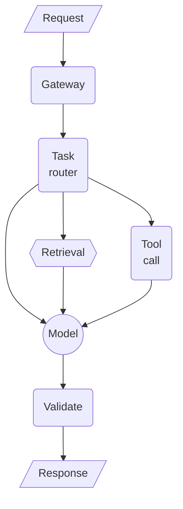

# Designing an AI System

A prompt is a demo. A product is a system around it: authentication, retrieval, tools, queues, caches, retries, evaluation, and a plan for the moment the model is wrong. Most AI incidents are not model failures. They are design failures — the wrong workload shape, an unbounded cost, a missing fallback, or no baseline to compare against.

This tutorial is the method. The two case studies that follow apply it to an interactive support assistant and a batch enrichment pipeline.

```callout
**In one sentence:** design the workload before the model — who waits, how often, how wrong is acceptable, and what happens on failure — then choose the simplest architecture that meets those numbers.
```

## The model is the smallest box

The classic paper on machine learning technical debt made the point years before LLMs: the model is a small part of a real system, and the surrounding data dependencies, configuration, serving path, and monitoring are where the complexity lives. The same is true here. A production LLM feature is mostly plumbing:

- a gateway that authenticates, rate-limits, and routes
- retrieval and prompt assembly
- tool calls with their own permissions
- validation of what comes back
- caching, retries, and fallbacks
- traces, evals, and a human escalation path

If your design discussion starts with "which model," you are optimising the smallest box first.



## Four questions before architecture

Write these down before you draw anything. They eliminate most architectures immediately.

| Question | Why it decides the design |
| --- | --- |
| **Who is waiting?** A person, a batch job, or nobody | Sets the latency budget and whether streaming matters |
| **What is the volume shape?** Steady, spiky, or nightly | Decides queueing, concurrency, and whether batch pricing applies |
| **How wrong can it be?** Cost of a false positive vs a false negative | Sets the quality bar and where humans belong |
| **What happens when it fails?** Retry, degrade, queue, or refuse | Determines the failure path you must build on day one |

The answers cluster into a few workload archetypes:

| Archetype | Latency budget | Cost model | Failure strategy |
| --- | --- | --- | --- |
| Interactive assistant | First token under ~2s | Per request | Handoff or fallback answer |
| Inline completion | Under ~300ms | Cached, small model | Silently show nothing |
| Batch enrichment | Hours | Per record, batch discount | Dead-letter and retry |
| Long-running agent | Minutes to hours | Token budget per run | Checkpoint and approval |
| Embedded classifier | Under ~100ms | Per call, tiny model | Deterministic rule |

A support assistant and a nightly enrichment job are different products even if they call the same model. Designing them the same way is how you get a chat UI bolted onto a batch workload, or a 24-hour SLA on a request a user is watching.

## Four budgets, one architecture

Every design choice spends one budget to buy another.

- **Latency** — time to first token, and time to complete.
- **Cost** — per request, per outcome, per tenant.
- **Quality** — accuracy, faithfulness, coverage.
- **Risk** — what happens when it is wrong, and who is exposed.

The levers move more than one budget at a time:

| Lever | Buys | Costs |
| --- | --- | --- |
| Bigger model | Quality | Latency and cost |
| Retrieval | Freshness and grounding | Latency, plus a new failure mode |
| Prompt caching | Cost and latency | Staleness; cache invalidation work |
| Batch API | Up to 50% lower cost | No interactive latency |
| Human review | Lower risk | Cost and throughput |
| Routing to a small model | Cost and latency | Quality on hard cases |
| Guardrails | Lower risk | False refusals, extra latency |

If a proposal claims to improve everything at once, ask what it is spending. Usually it is spending engineering time, and that is a real budget too.

## Choose the simplest shape

Anthropic's guidance from *Building effective agents* is the right default: find the simplest solution possible, and add complexity only when it demonstrably improves outcomes. They draw a useful line between **workflows** — LLMs orchestrated through predefined code paths — and **agents**, where the model directs its own process. Workflows are predictable; agents are flexible and more expensive.

| Shape | What it is | Use when | Main cost |
| --- | --- | --- | --- |
| Single call | One prompt, maybe with retrieval | The task fits one context | Quality ceiling |
| Chain | Fixed steps, each feeding the next | The task decomposes cleanly | Added latency |
| Router | Classify, then send to a specialist | Distinct query types | Misrouting |
| Parallel | Independent calls, then aggregate | Speed or multiple checks | Token fan-out |
| Orchestrator | A lead plans and delegates | Subtasks are unknown up front | Coordination |
| Agent | Model loops with tools | Path cannot be hardcoded | Unpredictable cost |

Most products need a router and a chain, not an agent. Agents earn their cost when the number of steps genuinely cannot be predicted — coding tasks, open-ended research — not because the demo looked better with a loop.

## Budget the request path

Latency is a sum, not a feeling. Write the budget per hop:

| Hop | Typical budget | Notes |
| --- | --- | --- |
| Auth and rate limit | 10–30ms | Keep it off the model path |
| Retrieval | 50–150ms | Cache embeddings; cap top-k |
| Model time to first token | 300–800ms | The number users feel |
| Tool call | 100ms–2s | Often the hidden tail |
| Validation | Under 10ms | Never call a model to validate JSON |
| Streaming to completion | 1–10s | Depends on output length |

If the sum exceeds the budget, remove a hop before shrinking the model. A reranker that adds 200ms to save a marginal quality point is a bad trade for an interactive product and a fine trade for a batch job.

## Design the failure path first

Every model call can time out, hit a rate limit, refuse, return invalid output, or return a confident wrong answer. Decide the response per feature:

| Failure | Detection | Response |
| --- | --- | --- |
| Timeout | Deadline exceeded | Retry once with jitter, then fallback |
| Rate limit | 429 | Queue with backoff, or route to a second provider |
| Refusal | Explicit refusal field | Handoff or a safe canned response |
| Invalid output | Schema validation | Repair once, then fail closed |
| Wrong but valid | Evals, user feedback | Human review, not an automatic retry |
| Provider outage | Health check | Cached answer or degraded mode |

The important decision is **fail open or fail closed**. A help-centre answer can fail open to search results. A refund action must fail closed and hand off to a person. Write this down per tool, not per system.

## Do the cost arithmetic before you build

A napkin model beats a surprise invoice. For a chat-shaped feature:

```text
monthly_cost =
  requests
  × calls_per_request
  × (1 + retry_rate)
  × (input_tokens × input_price + output_tokens × output_price)
  + retrieval_cost
  + eval_cost
```

Example: 30,000 tickets a month, 1.2 model calls per ticket, 5% retries, 2,000 input tokens and 300 output tokens per call. That is 37,800 calls. Plug your provider's current prices into the token terms, then add embeddings, reranking, and the eval sample. The absolute number matters less than the shape: calls per request and tokens per call are the two levers you control.

Three costs people forget:

- **Reasoning tokens** are billed as output even though you never see them.
- **Cache reads** are much cheaper than fresh input, but only if the prefix is stable.
- **Retries and evals** are real traffic. A 10% retry rate is a 10% cost increase.

Then convert to the unit the business cares about: cost per resolved ticket, per 1,000 records, per active user. Token prices change; unit economics is the durable number.

## Define quality before you build

"The model seems good" is not a quality bar. Write three things:

1. **What good looks like** — a rubric or a labelled example.
2. **What unacceptable looks like** — the failure you will not ship.
3. **How you will measure it** — a golden set, an online metric, and a human review sample.

A useful split is offline and online. Offline is a fixed dataset you run on every prompt or model change. Online is production behaviour: resolution rate, escalation rate, thumbs-down rate, edit distance on generated fields. The [golden datasets](../tutorials/eval-golden-datasets.md) and [eval harness](../tutorials/eval-harness-ci.md) tutorials cover the mechanics.

Set the ship gate before the first build, or the first build becomes the gate.

## Roll out in stages

| Stage | What you learn | What must be true |
| --- | --- | --- |
| Shadow | Does it agree with humans on real traffic? | No user sees the output |
| Internal | Is it usable by people who will complain? | Feedback channel exists |
| Canary | Does it hold at 5% of traffic? | Kill switch and dashboards |
| Ramp | Does quality survive the long tail? | Cost per outcome is stable |
| Default | Is it better than the old path? | Evals and support are staffed |

Version prompts and model names together, and log both on every request. "It got worse last Tuesday" is unanswerable if you cannot tell which of the two changed.

## The one-page design doc

The deliverable of this method is short:

```markdown
## Problem
Who has it, how often, and what they do today.

## Workload
Who waits, volume shape, latency budget, cost ceiling.

## Architecture
One diagram: client, gateway, retrieval, model, tools, stores, human.

## Budgets
Latency per hop, cost per outcome, quality bar, risk boundary.

## Failure paths
Per failure: detect, retry, fallback, fail open or closed.

## Evaluation
Golden set, online metrics, human review sample, ship gate.

## Rollout
Shadow → canary → ramp, with kill switch and owners.

## Open questions
The three things that could invalidate the design.
```

If it does not fit on a page, the design is not clear yet.

## Common failure modes

| Symptom | Likely cause | Fix |
| --- | --- | --- |
| Great demo, bad product | Only the happy path was designed | Add failure paths and a quality bar |
| p95 latency is unacceptable | No per-hop budget | Measure each hop; cut or cache the worst |
| Margin disappears at scale | Cost per token, not per outcome | Model the unit economics; route and cache |
| Agent loops and bills | Agency used where a workflow fits | Replace with a router or fixed chain |
| Provider outage takes the product down | No fallback or degraded mode | Cache, second provider, or fail gracefully |
| Cannot tell if a change helped | No baseline or version logging | Golden set plus prompt/model versioning |
| One tenant sees another's data | Retrieval scope is in the prompt, not the query | Enforce tenancy in code |
| Long tail dominates cost | Average-case design | Segment traffic; route the tail differently |

## A checklist

- Can you state who waits and for how long?
- Is there a cost ceiling per request and per outcome?
- Did you choose the simplest shape that meets the bar?
- Is there a latency budget per hop, not just end to end?
- What happens on timeout, refusal, invalid output, and outage?
- Which actions fail closed, and which may fail open?
- Is the quality bar written down before launch?
- Can you compare this week's quality to last week's?
- Are prompt and model versions logged together?
- Is there a kill switch, and has someone tested it?

## Worked example

A product engineer applies the four questions to an inline email-reply suggestion feature before drawing any architecture.

**Input:** 50,000 daily active users × 8 suggestions each = 400,000 calls/day; p95 TTFT budget 300ms; a wrong suggestion that gets auto-sent is customer-visible.
**Output:** Classified as inline completion → one small model with a cached prefix, no retrieval and no agent loop; p95 TTFT 240ms, $40/day, and low-confidence suggestions simply do not appear.

- **IF** a person waits on every keystroke **THEN** the archetype is inline completion and the budget is 300ms to first token, not 2 seconds.
- **IF** retrieval adds 120ms at p95 for a marginal quality gain **THEN** drop it — spend the budget on latency.
- **IF** the output can be auto-applied **THEN** fail closed on low confidence; if the user must accept it, fail open by showing nothing.
- **IF** volume passes 300,000 calls/day **THEN** use a stable cached prefix; do not trade cost for an agent loop.
- **OUTCOME:** simplest shape that meets the bar is a single cached call; no diagram was needed until the workload was written down.

Four questions picked the archetype, and the archetype picked the architecture — the order the method is built around.

## Glossary

- **Workload archetype** — the traffic and latency shape of a feature.
- **Budget** — an explicit limit on latency, cost, quality, or risk.
- **Workflow** — LLM steps orchestrated through predefined code paths.
- **Agent** — a system where the model directs its own process and tool use.
- **Fail open / fail closed** — degrade to a permissive path, or refuse safely.
- **Unit economics** — cost per resolved ticket, record, or user.
- **Ship gate** — the evaluation threshold a change must pass.
- **Shadow mode** — running a new system on real traffic without showing its output.

## Wrapping up

Design the workload, set four budgets, pick the simplest shape, and write the failure path before the prompt. The model will change every few months; the shape of the problem will not. Get the shape right and swapping models is an afternoon. Get it wrong and every model upgrade is a redesign.

Next: apply this to an [interactive support assistant](../tutorials/design-support-agent.md), then to a [batch enrichment pipeline](../tutorials/design-batch-pipeline.md).

## Sources

- Anthropic, [Building effective agents](https://www.anthropic.com/engineering/building-effective-agents), December 2024 — workflows vs agents, prompt chaining, routing, parallelisation, orchestrator-workers, and "simplest solution first."
- Sculley et al., [Hidden Technical Debt in Machine Learning Systems](https://papers.nips.cc/paper/2015/hash/86df7dcfd896fcaf2674f757a2463eba-Abstract.html), NeurIPS 2015 — the model as a small part of a larger system, glue code, configuration debt, and changing-anything-changes-everything.
- OpenAI, [Batch API](https://platform.openai.com/docs/guides/batch) — asynchronous workloads, 50% cost discount, separate rate limits, 24-hour completion window.
- Anthropic, [Prompt caching](https://platform.claude.com/docs/en/build-with-claude/prompt-caching) — cache reads at a fraction of input cost, prefix stability, and cache invalidation.
